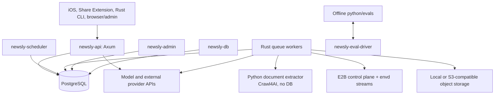
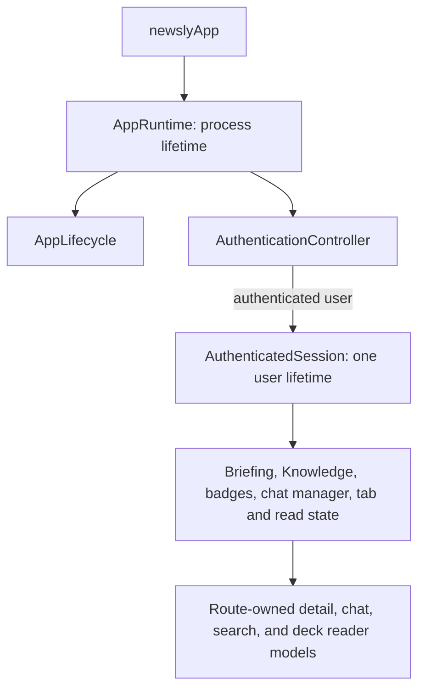

# Newsly Architecture

This document describes the authoritative Newsly system. For behavior that must
remain true, use [`docs/laws/`](laws/). Dated implementation and validation
records live in [`docs/log.md`](log.md) and repository history.

## 1. System summary

Newsly is a Rust modular monolith backed by PostgreSQL, with a native iOS app
and a Rust CLI. It ingests long-form Content and short-form News, builds
Briefings, supports Knowledge, chat, Learning Decks, audio, onboarding,
integrations, and agent workflows, and executes durable background work from a
PostgreSQL queue.

The production backend stack is:

- Rust 1.94, edition 2024;
- Axum, Tokio, and Tower for HTTP, middleware, and process orchestration;
- SQLx 0.9 for every PostgreSQL query and migration;
- Serde, Utoipa, and Schemars for wire, OpenAPI, task, tool, and model schemas;
- Rig behind a Newsly-owned agent interface;
- `async-openai` and typed `reqwest` adapters for provider-native APIs;
- direct E2B HTTP and ConnectRPC transport;
- `tracing` for structured observability.

PostgreSQL is both the durable state store and task queue. There is no Redis,
Kafka, Temporal, external vector database, or second workflow authority.

Newsly-owned Python has two explicit boundaries:

- `python/document_extractor` is the private, database-free Crawl4AI extraction
  process used by Rust workers;
- `python/evals` is offline model, embedding, judge, and report tooling.

No other Newsly-owned Python package owns routes, SQL, migrations, queue rows,
product state, agents, E2B, admin behavior, or production scheduling. The Rust
application image installs the pinned third-party `yt-dlp` executable and its
Python runtime for bounded media downloads; that vendor tool is not Newsly
application code or an authority boundary.

## 2. Runtime topology



Production images are split by responsibility:

- the Rust application image supplies API, scheduler, database, admin,
  account-deletion, sandbox-helper, and one multicall queue-worker binary. The
  worker is exposed under process-specific aliases so Supervisor retains
  independent process, restart, queue-scope, and shutdown boundaries without
  linking the shared worker graph once per queue. The image also includes the
  pinned third-party `yt-dlp` executable/runtime used only as a Rust-controlled
  media subprocess;
- the isolated extractor image contains Crawl4AI, browser dependencies, and
  extraction policy but receives no application database environment or volume;
- eval dependencies are excluded from production images.

Tokio channels and PostgreSQL notifications provide process-local wakeups. They
never replace durable queue or progress state. API replicas can scale
independently; singleton or partitioned background processes coordinate through
PostgreSQL leases and advisory locks.

## 3. Rust workspace and dependency direction

The Cargo workspace is under `rust/`.

| Crate | Authority |
|---|---|
| `newsly-api` | Axum routes, middleware, auth extraction, error projection, admin HTTP, Utoipa document |
| `newsly-contracts` | Public/task/provider wire types and generated schemas |
| `newsly-contract-codegen` | Fail-closed Swift app and Share Extension generation from Rust OpenAPI |
| `newsly-domain` | Product identifiers, states, ownership, and durable vocabulary |
| `newsly-db` | Shared SQLx repositories, cross-feature PostgreSQL operations, migrations, database CLI |
| `newsly-queue` | Claim, lease, retry, defer, cancel, notification, and finalization kernel |
| `newsly-worker` | Task executors and typed process dispatch for queue-specific worker aliases |
| `newsly-scheduler` | Recurring task fan-out and queue maintenance |
| `newsly-providers` | External model, search, media, social, and storage adapters |
| `newsly-agent-runtime` | Newsly agent loop and replaceable Rig engine |
| `newsly-e2b` | Direct task-sandbox creation, streaming, files, network policy, and teardown |
| `newsly-extraction` | Typed client for the private Python extractor |
| `newsly-eval-driver` | Canonical algorithms exposed to offline evaluations |
| `newsly-admin` | Ownership, health, task, usage, and eval-export operations |
| `newsly-cli` | Authenticated user-facing `newsbuddy` HTTP client, local config, and Markdown library sync |
| `newsly-smoke` | Opt-in black-box API scenarios for the disposable local-staging Compose stack |
| `newsly-vm-bootstrap` | Credential-free sandbox feed/capability helper |
| `newsly-account-deletion-worker` | Idempotent account and external-resource deletion |

The dependency direction is:

```text
Axum route / worker process
    -> application command, query, or task executor
        -> domain types and Newsly-owned gateway traits
            -> SQLx, provider, storage, extractor, or E2B adapter
```

Routes do not contain SQL or provider workflows. Shared persistence contracts
live in `newsly-db`; feature-local SQL remains private to a repository module in
the owning runtime crate. Provider crates do not depend on `newsly-db`. SQLx
repositories return owned projections, never handles that can lazily acquire
data later. SDK-native objects do not cross into public, domain, or persistence
layers.

Content-body and Learning Deck storage use the startup `ObjectStorageBackend` in
`newsly-providers`, with trimmed local/S3 settings, HTTP(S)-only remote endpoints,
paired credentials and a 1–300 second timeout. Local reads and deletes share
canonical containment, regular-file and immutable-key validation. Product caps
remain explicit: chat/content/news reads keep their existing limits,
summarization keeps 4,000,000 bytes, and API/Learning Deck source reads allow
20 MiB. Hosted deck artifacts retain their route-specific limits. Local deletion
unlinks the requested entry rather than following its symlink target. S3 remains
supported until production storage configuration is verified for any retirement.

## 4. Contracts and type system

### 4.1 Public contract authority

The `newsly-api` Utoipa document is the only route and public-schema authority.
It generates or supplies:

- `contracts/openapi/public.openapi.json`;
- checked Swift app and Share Extension artifacts generated by
  `newsly-contract-codegen` from the public schema and the reviewed
  `contracts/client_codegen_policy.toml` surface policy;
- shared Rust request and error types consumed directly by the `newsbuddy` CLI.

`scripts/regenerate_public_contracts.sh` performs intentional regeneration and
`scripts/check_public_contracts.sh` rejects drift. Public contract tests verify reviewed operation IDs, responses and wire fields. Client
generation also fails closed on missing registered schemas, target-crossing
references, unsupported unions, or unreviewed untyped JSON fields.

Every public failure uses one typed envelope. Intentional 204 and streaming
responses are explicit exceptions, not untyped escape hatches.

### 4.2 Representation rules

The compatibility corpus captures persisted-data and installed-client
semantics. Rust preserves those semantics through explicit boundaries:

- Serde owns wire and durable encoding;
- Utoipa owns public OpenAPI;
- Schemars owns LLM and tool JSON Schema;
- explicit validation and `TryFrom` conversions enforce domain constraints;
- public, domain, database, and provider types remain distinct;
- absent, explicit `null`, and defaulted values are modeled deliberately;
- tagged unions replace unrelated nullable state bags;
- open versus closed enum policy is explicit;
- timestamps are typed RFC 3339 UTC values serialized with `Z`;
- legacy JSONB remains lenient only at documented compatibility boundaries.

Rust never persists Rig, `async-openai`, ConnectRPC, or E2B SDK types. Agent
history uses a versioned Newsly transcript with an explicit legacy decoder.

Pagination emits unpadded URL-safe cursors with UTC timestamps and route-bound filter hashes.
The API retains decode-only support for cursors issued before the October 2026 consolidation:
canonical padded URL-safe encoding, naive UTC timestamps and each route's original filter hash.
Legacy hashes must still match the active filters; hashless cursors are rejected. Remove this
compatibility only after installed-client cursor evidence establishes that persisted old cursors
are no longer in use. Invalid Briefing lens cursors return `409 stale_cursor`, allowing installed
clients to discard their saved continuation and reload; other cursor validation stays route-owned.

### 4.3 Canonical product identities

Long-form/legacy Content and short-form News are separate concepts with
independent keyspaces, DTOs, routes, and repositories. A Content lookup never
falls back to a same-number News row. Cross-product relationships are explicit
foreign keys or canonical links, not integer coincidence.

Submission status uses one canonical discriminated result with content, feed
subscription, Learning Deck, and no-action variants. Generated Swift clients
and shared Rust contracts expose that union. Temporary installed-client
top-level fields mirror the canonical result and must agree with it until
compatibility telemetry permits their removal. Pagination returns a real count
or does not claim a total. Generated wire types include the Share Extension.

## 5. PostgreSQL and SQLx

### 5.1 Data shape

PostgreSQL stores:

- users, Apple identity, refresh replay, API keys, integrations, and deletion;
- canonical `contents`, body storage references, per-user visibility, read and
  Knowledge state;
- canonical `news_items`, source snapshots, relations, clusters, embeddings,
  read state, and Briefing publication state;
- chat sessions, versioned messages, confirmed final text, tool progress, and
  stream-generation fences;
- durable `processing_tasks`, queue leases, retries, ownership stamps, and
  failure diagnostics;
- Briefing, Learning Deck/LLM-task, audio, onboarding, discovery, discussion,
  usage, feedback, and task-sandbox attempt state;
- runtime ownership, replica acknowledgement, and audit records.

The schema uses PostgreSQL-specific JSONB, GIN/trigram/FTS, advisory locks,
partial indexes, `ON CONFLICT`, transaction timestamps, `SKIP LOCKED`, and
`LISTEN/NOTIFY`. SQLx keeps that behavior visible as parameterized SQL rather
than hiding it behind an ORM.

### 5.2 SQLx migration authority

Alembic was frozen at `20260829_02` before its source tree was removed. Its 91
historical revisions remain accessible through repository history, while the
audited catalog and compatibility evidence live in the SQLx baseline and
contract corpus. Alembic cannot be edited or executed for schema evolution.

The first embedded SQLx migration is the complete audited catalog at that head.
Fresh databases run it. Existing databases require deliberate adoption under a
maintenance barrier. One advisory lock spans:

1. Alembic-head, catalog, bounded data, extension, role, and grant verification;
2. recognition of an empty or exact checksum-matching SQLx prefix;
3. checksum-preserving baseline recording;
4. the first pending SQLx migration run;
5. final catalog verification.

Gaps, checksum mismatches, invalid indexes/constraints, unexpected roles or
grants, and unverified skip requests fail closed. API and worker replicas do not
auto-migrate; the exact-image `newsly-db` process runs migrations once before
application rollout.

Later changes use expand, compatible code, bounded backfill, validation, then
contract. Production rollback normally uses forward-compatible schema or a
roll-forward repair rather than destructive down migration.

## 6. API, authentication, and errors

`newsly-api` owns public, machine-facing, Share Extension, and server-rendered
admin routes. Middleware provides request IDs, structured tracing, panic/error
projection, compression where appropriate, CORS policy, timeouts, and health.

Authentication supports:

- Apple Sign In with issuer, audience, RS256, and JWKS validation;
- HS256 access and refresh tokens with exact claim compatibility;
- replay-safe refresh rotation keyed by old-token hash and durable attempt ID;
- `newsly_ak_...` API keys stored only as SHA-256 hashes and compared in constant
  time;
- signed admin-session cookies;
- encrypted integration credentials;
- account deletion with queue, data, object, and E2B cleanup.

Refresh replay is serialized by PostgreSQL advisory lock. A repeated old token
and matching attempt may receive its short-lived encrypted replacement pair; a
different or missing attempt after consumption is rejected. Corrupt replay
material fails closed and cannot mint a second pair.

The typed public error envelope exposes a stable code, safe message, structured
details where useful, and request identity. Internal sources and provider data
remain in structured logs, not client messages.

## 7. Durable queue and worker execution

`processing_tasks` is the only durable work queue. Each task has one payload
schema, queue/partition, retry and deferral policy, runtime namespace, and
executor.

Claim filters work by the worker's runtime and namespace, then uses `FOR UPDATE
SKIP LOCKED`. Each claim carries durable owner and executor-version stamps plus
an opaque lease token and retry generation. Renewal, progress, defer, retry,
terminal failure, and success are compare-and-set operations requiring those
exact stamps, token, generation, and an unexpired lease. Expired work is
reclaimable. Deferral preserves the retry budget. Notifications wake workers;
polling remains the correctness fallback.

Normal Briefing claims additionally exclude another `processing` refresh for the
same owner. A partial unique index closes concurrent claim snapshots; only its
named conflict retries the claim transaction, at most three times. Expired work
retains that slot until reclaimed under a new exact lease. Append, sweep and Full
retain their existing task identities, so pending Full work is not absorbed by an
append. There is no second owner lease or refresh-intent table.

Native and supervised runtimes use two News extraction, two News processing and
two shared-lens consumers with disjoint task scopes.
The shared multicall worker remains serial per process; concurrency comes from
bounded process replicas, with unique identities and small per-process DB pools.
Briefing uses two consumers (configurable down to one), each limited to six
composition calls, preserving the prior default total of twelve. JEV and filter
phases each retain their separate four-call bound per active refresh. These bounds
are capacity limits, not measured provider throughput guarantees. Container pools cap
each serial worker at two connections, each API slot at five and the scheduler at
two. Including 23 dedicated worker listeners and both API slots, the default
ceiling is 81 connections against PostgreSQL's 100, leaving operating headroom.
The first rollout requires an explicit maintenance cutover that stops both old API
slots, workers and scheduler before migrations. Only the new API slot resumes, so
the old twenty-connection pool cannot overlap the expanded worker topology. The
next ordinary deployment recreates that stopped slot with the five-connection cap.
The grouping trigger and Briefing owner index require a migration-session barrier
attestation on populated databases. The owner precheck and plain unique-index build
commit atomically with SQLx history while writers are stopped.

Every provider-backed executor follows:

```text
prepare transaction
  validate task, owner, user, and product state
  load owned fields into an immutable plan
  commit

external phase
  no transaction or checked-out DB connection
  bounded, cancellable provider/extractor/E2B/storage work
  lease heartbeat through separate short operations

finalize transaction
  lock exact lease and canonical product rows
  revalidate ownership, generation, and lifecycle
  publish product state, usage, downstream tasks, and queue transition atomically
```

A lost or superseded attempt cannot publish. Attempt-scoped files are renamed
only after the fenced transaction proves authority; failed or superseded files
are cleaned without touching canonical output.

User-scoped content transactions acquire the active user lock before the
canonical content lock. When attribution must first be discovered from content
metadata, finalization performs an unlocked read, locks that user, then locks
and revalidates the content row; an attribution race releases only the content
lock and repeats that bounded lock sequence without repeating external work.

Rust owns the active runtime for every task. Workers claim only matching runtime
namespaces; the durable owner and executor-version stamps carried by the claim
remain authoritative audit and fencing evidence for that attempt.

The executor version is an authority-transition epoch, not an application build
number. A worker is selected by runtime and namespace, then renews and finalizes
the exact stamp it claimed. The ownership registry remains because P23 permits
audited runtime transitions and keeps in-flight work bound to its original
owner. Removing it would require an explicit change to that law, its schema, and
the admin transition workflow; it is not a mechanical migration cleanup.

## 8. Product processing

### 8.1 Content and extraction

Submission creates product state and its processing task together. URL analysis
and content processing use Rust for canonicalization, public-network policy,
feed/media routing, body storage, lifecycle, retries, usage, and downstream
enqueueing.

For documents, Rust calls the private Python extractor. The extractor owns
Crawl4AI, warm-browser recycling, static readability/trafilatura comparison,
publisher cleanup, access-gate detection, table extraction, GitHub handling,
PubMed delegation, and the decision that Firecrawl is required. Rust owns the
Firecrawl credential and call, persistence, and retry policy.

PDFs with a readable text layer use bounded local Poppler tools and retain every
page. Scanned, malformed, or locally uninspectable PDFs request the existing
Firecrawl fallback, including during static analysis; Rust alone owns any paid
provider call. A complete text body exceeding the configured byte limit fails
explicitly rather than dropping pages. Poppler subprocesses are deadline-bound
and reaped on cancellation; container resource limits bound the process host.
Firecrawl billing uses provider-reported credits and the configured per-credit
rate. Missing credit quantities or a usable rate leave cost unknown, and usage
is recorded at dispatch and observed response boundaries independently of product
finalization. Each invocation has its own durable identity, including cancelled
or malformed responses whose credit quantities remain unknown. The configured
price is an account-specific marginal top-up estimate before tax, not an invoice
or an inferred subscription allocation; an absent price remains unknown.

An HTTP 402 closes one shared PostgreSQL Firecrawl credit gate and activates the
existing durable pipeline alert. Local extraction continues. Work requiring
Firecrawl defers without consuming retries or publishing terminal extraction
failure; deferred News enrichment waits for article evidence before downstream
summarization. After a fifteen-minute cooldown one ordinary queued article may
probe recovery under a six-minute lease. Matching successful probes clear the
pause and signal recovery; failed/abandoned probes retain the pause, and stale
responses cannot clear a newer incident. Schema installation never requeues
historical failures.

The database-free extractor emits bounded local-stage/reason counters and fallback
diagnostics without raw exception strings or article text. Rust retains those
counters and the fallback decision with provider usage so domain improvements
can be based on fetch, quality, browser, or PDF failure evidence.

Content bodies are staged by hash and published only through the exact fenced
transaction. Feed links returned by extraction are candidates; Rust validates
and persists subscriptions/backfill work.

Deck-only submissions share the canonical content identity but carry a durable
source-only processing flag. They extract readable source text without editorial
summarization or content artwork. An ordinary submission clears that flag and
reenqueues full processing when the source-only row had completed; requesting
a deck from already processed content does not downgrade it.

Scheduled and backfill dispatchers enqueue one task per configured feed/Reddit
source or global aggregator. Each leaf prepares only its selected configuration,
runs provider work independently, and fences that configuration at persistence.
Scheduled feed normalization accepts unseen head entries and stops at the first
known entry. Explicit catch-up skips known/rejected entries before its intake
limit; per-entry savepoints retain healthy siblings on input constraint failures.
Source health records successful checks separately from newly persisted items.
Typed source outcomes keep transient HN/topic failures retryable while committing
healthy items. Source HTTP Retry-After hints reach the queue, which adds positive
jitter to failure retries; prerequisite deferrals keep their original delay.

Feed validation and ingestion share pinned public HTTP with redirect revalidation
and a total request deadline. Candidate probes retain byte limits; accepted feed
documents retain the product's no-byte-cap policy. X synchronization persists
continuations without advancing the settled bookmark checkpoint prematurely.

### Pipeline interruption recovery

Expired claims consume the existing retry budget for every task type. A worker
attempt has a two-hour outer deadline; sandbox-backed LLM tasks drain bounded
allocation/cleanup work after cancellation so a dispatched sandbox ID is not lost.
Terminal failure settles the active product projection and queue transition in the
same exact-lease transaction. Discovery and chat generation guards preserve newer
attempts. The scheduler evaluates each job's latest occurrence after downtime;
existing durable tick markers suppress duplicate scheduling. The existing
watchdog and operator health share read-only counts for repeatedly failing
sources, overdue work, and terminal queue/product mismatches. Repairs remain
owned by normal feature tasks.

### 8.2 Short-form News

News enrichment may obtain article evidence through the same extractor and
Rust Firecrawl boundary. Extraction failure is soft when metadata-only
processing remains possible.

Processing reuses a durable or exact-representative summary before paid work,
bounds evidence, runs canonical relation policy in Rust, and performs production
embeddings through the configured hosted adapter. Local SentenceTransformers
and experimental rerankers belong only to offline evals.

A new summary and its usage first checkpoint under the exact queue lease and source
fingerprint. Relation retries reuse that checkpoint; substantive source changes invalidate it.
Polling preserves the first discovery timestamp; fingerprints exclude only verified
non-input engagement counters and scrape clocks. Summary finalization overlays its
result on the already-fenced current row metadata, preserving refreshed counters.
Summary, relation/cluster state, relevant links, Briefing pending sources, Agent
Data synchronization, and the queue transition publish atomically. Observed paid
usage persists through its checkpoint or independent ledger before publication. News never enters the long-form generated-artwork path.

News relation preparation caches exact source/text/provider/model/encoder vectors
separately from the shared Briefing story vectors, plus fingerprinted optional link
results. External work holds no connection. Finalization takes a nonblocking
transaction-scoped guard for the exact visibility/owner pool before querying fresh
candidates and running the canonical Rust matcher. Missing fresh artifacts and
contention defer within a durable count/age budget for the current conflict episode.
Provider retries start a new episode; other completed News outcomes clear it,
including credit deferrals. Nonpublication failures retain their provider backoff
without taking an unrelated grouping guard. Reprocessing preserves the
last ready representation, and representative merges move all prior members.
A database trigger guards candidate-affecting writes from every writer; operator
repairs must not disable that trigger or use TRUNCATE to bypass it. The guard uses
a dedicated two-integer advisory namespace, separate from scheduler bigint locks.
Subscriber pending insertion, counts and deadline advancement use set-based SQL;
canonical queue insertion still owns per-task validation and notification. Enabled
personal filters receive coalesced admission wakes without inserting unversioned
pending rows. A known processing append gets a pending sweep wake; the remaining
query-to-claim race relies on bounded sweep recovery. Composition retains its
editorial batching policy.

Shared aggregator checks use `source_ingestion_health`: news sources target 15/60
minutes for active/no subscribers, and daily research-paper sources retain 60/120
minutes. Eligibility allows five minutes of tick grace and queue retries keep their
backoff. Global fetches do not fence against every subscriber configuration. The
scheduler owns routine fetches; onboarding reuses recent successful shared checks
and settles a missing check after 45 minutes. Brutalist snapshots the catalog topics
selected by active subscribers; each serialized new-topic transition queues a fetch without absorbing it into an
already-running older snapshot, including a topic removed and re-added in flight. First-run
attachment waits for active Brutalist fetches. Its rolling 12-new-item topic/section
budget is serialized by a short finalizer advisory lock; capped sections still update
existing stories. Topic union runs under the existing matching-story row lock, and
one forward migration extends the inlinable `aggregator_config_admits` predicate for
cross-listed metadata. HTTP writes and chat aggregator subscriptions share the worker
audience-transition command. Creation, reactivation and topic changes compare demand
transactionally and enqueue bounded skipped-fallback re-enrichment for a new audience.
`newsly-domain::AggregatorKey` is the backend aggregator catalog: keys, display names,
and offered topics, which config and onboarding normalization validate against. Configs
store catalog-spelled keys and topics. Which global items a subscription admits is owned
by the migration-defined SQL function `aggregator_config_admits(config, platform,
metadata)`. Every visibility query (feeds, counts, Briefing, chat, decks, worker
subscriber lookup) calls it, and it encodes no keys. Feed-sized queries materialize the
user's aggregator configs once; single-item lookups call it directly. The function must
stay one inlinable expression, which a database test guards. Changing the rule needs a
`CREATE OR REPLACE` migration. Adding an aggregator needs a catalog entry, its provider
fetcher, and the iOS onboarding option, which still lists keys and topics itself.
Ready representative news schedules `prepare_news_lens`, handled by a dedicated
`newsly-news-lens-worker` consumers using the existing worker binary dispatcher. `news_lens_embeddings` stores the canonical planner input hash, encoder
version, model and dimension-validated vector. Preparation releases its database
connection before provider work and finalizes through the exact queue lease.
Scheduler ticks backfill at most 128 eligible missing embeddings, including under
content-queue backpressure; foreground misses promote the same task. A short
exact-lease checkpoint stores the input hash/model/encoder before external work,
so terminal failures of any kind have a six-hour fingerprint-specific cooldown.
Briefing routes cached news with Jev summary decisions, isolates failed sources, and leaves
uncached news pending while publishing other ready tiers. Queue priority orders work within existing retry
fairness buckets, and promotion preserves `available_at` backoff. Successful vector
publication expedites only existing pending refreshes explicitly waiting on the
source, excluding provider retries. It creates no per-user embedding task. A
five-second recovery poll covers completion before the successor task exists.
Observed successful embedding usage is recorded before product finalization.

First-run news admission freezes up to 40 eligible stories in
`onboarding_first_edition_items`, balanced across platform/topic before recency.
The cohort settles through coverage, read state, or loss of eligibility before
normal admission resumes. Feed backfill records both reused and new content in
the same membership table. Article/podcast progress derives lifecycle and readable
coverage from canonical rows, while fixed lenses exist immediately. Active
first-run index responses include dynamic progress in their validator and bypass
conditional 304 responses. Aggregator checks persist a fixed cutoff and terminal
result on each run source; later fetches cannot reopen them. Terminal artwork and
ineligible items settle tier progress, and abandoned runs expire after 24 hours.
Item status writes do not acquire onboarding run locks through triggers.
Stale publication schedules at most three quick recoveries, then a one-minute
interval while initial news remains outstanding or the normal interval afterward.
A completing sweep releases its own dedupe key inside the exact-lease transaction
before enqueuing its successor. Online changes to existing-table indexes use separate
concurrent SQLx migrations; maintenance cutovers build indexes transactionally after
draining writers. Nonproductive initial sweeps without outstanding preparation wait
30–60 seconds; a bounded routing/filter pass or missing vectors retries after five
seconds. Active-run
projection reconciles sources once per response using a bounded ingestion window.

### 8.3 Briefing, discussions, media, and images

Briefing uses durable source/pending/publication state and versioned client
observation. Publication is atomic; partial provider success cannot expose a
half-assembled edition.

While the first news cohort is unsettled, incremental refreshes review at most one
parallel batch of four semantic category proposals and publish one complete news
window per durable task. Each coherent accepted proposal may create a category;
mixed proposals cannot serialize the discovery of healthy later siblings.
New categories take precedence over additional windows in existing categories;
unchanged inputs in composition cooldown are skipped. Remaining identities stay
pending, and the normal fenced finalizer schedules the next pass. Initial passes
defer compaction; explicit Full rebuilds retain complete preparation/publication.
Other refreshes name categories in ordered batches of at most four provider calls.
Naming results retain source-cluster order before fenced assignment. A failed
proposal remains pending while successful siblings can advance. Any failure stops
later paid batches; a wholly failed plan returns through the retry path.
Cancellation drops in-flight requests. Naming retries retain observed
usage across failed attempts; completed planning errors persist observed naming and
embedding usage in a separate short transaction, without publishing assignments.
Initial category naming reviews a bounded proposal and returns a complete partition
of its source identities into theme members and exclusions. The provider validates
the partition; the planner retains the existing minimum for named categories and
builds their centroids only from accepted members. Exclusions and mixed proposals
remain reachable through the separate general-news desk. Similarity packing only
forms proposals; it does not establish semantic membership.

Existing categories are assigned by pinned Jev decisions over title, summary and key
points, using the user's saved `briefing_lenses` title, deck and optional routing rule.
Instructions prioritize what the story mainly reports over supporting tools, vendors,
contracts or funding, while honoring explicit scope restrictions and exclusions.
Specificity resolves competing primary-subject fits. The selected model score must
reach 0.80; it is an acceptance threshold, not a calibrated probability of correctness.
A confident `other` can enter discovery;
uncertain or failed decisions use general news. At the ten-category limit, unmatched
stories use general news without cosine absorption. Unshown members of newly named
clusters remain pending until the next incremental task can route against the saved
category. Full rebuilds preserve their immediate coverage through general news.
Story embeddings remain cached for discovery, event grouping and nightly identity;
category-profile embeddings and their cosine routing thresholds are removed.

Routing continuously refills four single-attempt requests, each with a five-second
deadline. A twenty-second dispatch budget and lease loss stop new requests while
already-started calls drain; source-index ordering is restored. Undispatched sources
and their aligned vectors remain pending for a successor. Stale assignment rolls
back partial writes, retains observed usage, and defers the original task without
consuming provider retries: three five-second recoveries, then sixty-second waits,
with terminal diagnostics after five minutes of repeated conflicts within the same
provider-retry episode. A new retry or expired-lease reclaim resets that episode. Nightly-maintenance
and changed-filter waits clear it under the exact lease while retaining Full intent.
Completed naming-plan usage is recorded before lease and database checks, then
removed from the publication plan to prevent duplicate accounting. Cancellation
before naming returns remains an existing observation boundary. The existing
`AgentUsageRecorder` persists observed costs and tokens independently of naming and
fenced assignment publication; unknown billing remains unknown. Category definitions
need no new table or cache: the existing user-owned rows and complete lens/source
snapshot checks fence publication. Naming retains its separate
`BRIEFING_CATEGORY_NAMING_MODEL` setting. Normal refresh defaults to five minutes
(`BRIEFING_SWEEP_SECONDS`); naming maintenance keeps its existing nightly schedule.

News composition requests a single markdown field and converts it to the canonical
passage layout before the existing citation and layout checks. Article and podcast
composition retain the rich layout contract. Provider-owned rejection codes identify
failed constraints without logging source text; response-contract identity participates
in the composition fingerprint.
News event grouping reuses the shared story embedding cache only when input hash,
model, encoder and vector validation match; only cache misses reach the provider.
Cache reads release database connections before external work. Stage timings
separate cache lookup, embedding requests, naming and composition provider work.
Normal news catch-up admits at most 40 new pending stories per refresh and bounds
each unassigned routing snapshot and the total assigned-news composition snapshot
to 40. Admission shares slots across source/topic streams; composition shares
slots across active news lenses, retaining oldest pending order within each lens.
Deferred sources remain eligible or pending for later sweeps. Full rebuilds assign
any still-undecided original source to general news after bounded planning. A
publication-time coverage check prevents a partial or empty Full replacement from
retiring eligible old coverage. Ordinary preparation removes already-published
pending rows left by an abandoned Full, preserving exactly-once coverage.

Nightly news-category maintenance is a separate `recluster_news_lenses` task
and worker process. The authenticated profile owns a revisioned IANA timezone;
iOS reports it after validated authentication and real foreground transitions.
The scheduler scans indexed UTC due times, creates one run per user/local date,
and targets 03:00 local time with deterministic jitter inside a 03:00–05:00 window.
Historical accounts without a reported timezone remain unscheduled.

The domain fitter consumes at most 1,500 matching cached vectors from 14 days,
weights distinct events, preserves supported identities, and keeps weak matches
outside semantic centroids. Unsupported warm centers can yield fitting capacity
to uncovered topics. One candidate partition owns centers, membership, identity
and consecutive-night support; published routing profiles bootstrap the first
partition and do not displace unpublished candidate history on later nights.
A dedicated Luna request reviews at most ten categories with up to 25 diverse
representative stories each. Token reservations, attempt observations, and an
exact naming-input cache survive publication retries. Shadow mode is the rollout
default (`NEWS_CATEGORY_MAINTENANCE_MODE`); publish mode changes routing only
through the exact queue lease, unchanged snapshot, timezone revision, and night
window fences. Run startup validates the caller's original claim rather than
reading a replacement claim as execution authority. Cancellation permits an
in-flight naming call's append-only audit to finish but stops new reservations
and retries. A successor lease may use the remaining reserved attempt while an
old call drains; the two-attempt cap and independent usage audit still apply,
and this does not grant the old execution authority to publish. Pending
assignments for fitted, unpublished stories are cleared through one bound update.
The existing refresh then makes Jev decisions against the saved definitions; the
embedding partition never assigns those stories directly. Unfitted pending stories
retain the existing drain policy. Published segments are unchanged.
`accepts_news` separates future routing from existing readable
segments; empty draining lenses retire, while composed Markdown, source coverage,
and narration remain intact. Normal refresh and maintenance defer around each
other's active external-work phase. This work never owns new story embeddings.

Discussion collection and summary refresh have independent cadences and durable
claim fences. Scheduled catch-up materializes active eligible consumer, subscription
and cluster-read sets once, with the canonical visibility predicate inlined. The
single-item check immediately before paid work retains its shared database predicate
and the same 24-hour merge window. Initial summaries
accept admission, citation, or explicit open; later summaries require unread admitted
or citing consumers. Workers revalidate the discussion claim immediately before each
paid attempt, including merge fallback, and retain fetched comments when demand ends.

Scheduled feed selection stops at the persisted known-URL frontier; explicit
backfill uses a separate skip-known policy. Briefing composition shares one
CommonMark citation reader between provider validation and worker normalization.
Its correction budget is not nested inside provider schema correction, and
input/model/parser fingerprints retain a bounded failure cooldown across jobs.
Observed attempt usage commits under the original claim independently of edition
publication. The queue watchdog persists observations and versioned alert delivery
state in PostgreSQL; the existing HTTP transport delivers at least once with
deduplication, retry, reminders, and recovery. Operator incident and artwork
batches use explicit reviewed IDs and durable audits; migrations never enqueue
unbounded historical provider work. See the ingestion regression runbook.

Podcast and tweet-media workers perform bounded downloads, yt-dlp/ffmpeg
subprocess work, feed resolution, and transcription outside transactions.
Attempt files stay inside the configured root, reject symlinks/oversize input,
and are removed only after fenced state commits.

Generated long-form artwork uses an immutable summary fingerprint. Provider and
image transforms write attempt-scoped files without a database connection. The
final transaction revalidates the exact lease, fingerprint, and lifecycle before
publishing pointers to a unique immutable image/thumbnail pair, UTC cache version,
and usage together. Summary completion keeps articles and podcasts behind the image gate.
Successful image publication marks the source completed and enqueues it for Briefing, so Briefing
never publishes long-form content without artwork.

Deck bundles, agent logs, and generated image attempts register object keys before
writing. A bounded hourly reaper uses the same PostgreSQL registry with a one-day
grace period, retaining active work and published references. Cleanup failure
does not block publication.

### 8.4 Chat, Learning Decks, Share Actions, and research

Chat commands are accepted once and then observed through durable message/task
identities. Tool progress is separate from confirmed transcript text. Queue
lease plus chat stream generation fence every partial and final publication.
Provider response IDs remain in per-response accounting and transcript provenance.
HTTP-staged turns and worker-created Dig Deeper turns use one typed durable-context
constructor and Serde encoding; legacy decoding does not define new turn payloads.

Chat has no council execution path. Historical councils are converted under an explicit
maintenance barrier into the parent transcript plus the selected branch's visible follow-ups,
preserving session and message IDs. Other branch records stay hidden and archived. The conversion
refuses processing council messages and malformed ownership/boundary links. Validated database
constraints prevent older binaries from recreating council state. `newsly-db
verify-council-retirement` reports bounded, content-free blockers before the cutover.

The API owns temporary retired endpoint responses and inert council wire fields required by
installed clients: false mode, null branch IDs, empty candidates, and empty personas. Persona
profile inputs are accepted and ignored. Remove this compatibility only when minimum supported
clients and route telemetry establish it is unused. The DB owns a bounded decode-only vocabulary
for retired fields on ordinary queued turns; remove it after pre-cutover queued rows have settled.
Historical schema columns remain for retained records until the rollback/data-retention decision
allows contraction. Content audio discussion is independent of this chat retirement.

Directly verified Share feeds and articles/episodes use the existing host action
finalizer without starting an agent. Explicit chat and presentation requests also
build host actions from their validated input without an agent; presentation
persists its source and deck generation task in the fenced finalizer. Ambiguous
discovery retains the agent path; rejected feed output can recover only a
host-verified original item.

Learning Deck and Share Action agents use the same Newsly-owned agent runtime,
E2B session layer, workspace bounds, artifact validators, and signed artifact
URLs. `llm_tasks` is canonical for new Learning Deck work. The
`learning_deck_runs` ledger remains for stored legacy decks and their cleanup
until production counts, backfill verification, and an explicit schema
migration permit its retirement.

Learning Deck admission creates one canonical `llm_tasks` attempt per deck and one
`processing_tasks` delivery. The active-attempt unique index is per deck, so distinct
sources can wait durably while repeated requests reuse the unfinished attempt. Deck
deliveries carry an internal `task_kind: learning_deck` category. `RunLlmTask`
deliveries use the queue-owned typed constructor and require a `share_action` or
`learning_deck` category in their payload contract; enqueue and dispatch preparation
reject missing, malformed, or unknown categories. Queue claims exclude
another processing deck for the same owner; a partial unique index closes concurrent
claim snapshots, with bounded retries only for that named conflict. Expired work
retains its execution slot until reclaimed under a fresh exact lease. Normal queue
readiness ordering permits an independent deck to proceed during source waits before
generation begins. A pending delivery with durable generation state retains the user's
slot across automatic retry backoff; later decks cannot consume that attempt's remaining
wall-clock budget. The retry retains its original deadline. Generic completion and
terminal settlement release the execution slot. A matching expression index on the
text form of the generation task ID keeps reservation lookups indexed without casting
untrusted payload IDs.
Share Action deliveries do not participate in deck exclusion. The dispatcher checks
that a supported delivery's category agrees with its canonical workflow before any
provider work; terminal ledgers can still settle without invoking a provider.
The migration backfills supported pending/processing deck and Share Action deliveries
from the canonical ledger and requires a maintenance cutover so
old workers cannot bypass the new claim policy. User retries create fresh typed deliveries;
historical completed/failed queue records remain readable and are not reset for reuse.
Rolling back to binaries from before this
migration is unsupported while deck deliveries remain: those producers omit the category
and those workers lack the new exclusion and named-conflict retry policy.

Learning Deck generation defaults to `openrouter:anthropic/claude-sonnet-5.5`, using the
existing OpenRouter credential and fixed privacy routing. Its requests enable high-effort reasoning
and retain signed thinking for tool-result replay. OpenRouter Claude requests omit the unsupported
`parallel_tool_calls` parameter. Decks accept tool batches, preflight the whole batch against
the allowlist and remaining tool budget, then execute calls sequentially in response order.
Dependent calls must wait for their inputs. Other workflows keep their existing batch policy.
Other OpenRouter workflows retain their default reasoning settings.

Learning Deck generation starts a durable 900-second budget after source preparation,
configurable through `LEARNING_DECK_GENERATION_TIMEOUT_SECONDS`. Automatic deliveries reuse
that deadline; a new user-requested generation gets a new task and budget. Model phases stop
before the deadline to reserve snapshot, browser validation, and publication time. Sandbox TTL
includes a cleanup grace period and is separate from the generation budget. Every attempt
uses a fresh VM, with durable sandbox cleanup on interruption.

`learning_deck_generation_state` owns the task's input/contract fingerprint, deadline, and
private draft pointer. Checkpoint and progress writes fence the exact queue lease and current
nondeleted deck, serializing on queue then task without locking the deck. Immutable draft
manifests and content-hashed assets are registered before upload, bounded to 20 MiB of candidate
content, and never exposed through public deck artifacts. Automatic retries restore only the
same task's matching draft, validate it before another model call, and repair it when necessary.
Changed inputs or generation contracts discard the draft pointer without extending the deadline;
corrupt draft content is rejected and generation can restart only within the remaining budget.
Interrupted edits retain the last complete candidate; a normal model completion must validate
its current files and cannot silently fall back to an older draft. Deletion collects private registered
objects; interrupted uploads and terminal candidates use the existing artifact cleanup sweep.

The agent's `validate_deck` tool and final publication use the same static and Chromium checks.
Browser validation renders an exact root-owned, sealed copy of the captured candidate; publication
uses those captured bytes with the same viewer transform. Only explicit artifact defects are
model-repairable. Transport, ownership, and validator infrastructure failures preserve their
classification and retry the task within the original budget. Stage notes distinguish generation,
resume, checking, repair, retry, and publication while keeping the public running status. iOS
observes queue wait and source preparation in one bounded window, then generation in
a fresh window, each roughly sixteen minutes. Generation receives a fresh window only
once; repeated requeues do not
extend it indefinitely. A waiting deck retains its Queued label when observation pauses
and offers a read-only status refresh. Observation never starts another generation.

Dedicated Deep Research is retired. The API retains legacy enum decoding and historical reads, rejects retired create/write requests, and the worker settles old queued turns without invoking a provider. Ordinary chat owns research through its standard host tools. The API owns decode-only research labels until minimum-supported clients no longer send them and retained histories can be read without them; legacy database fields await a separate audited retention/schema contraction. No dedicated provider execution or aggregate billing path remains.

### 8.5 Onboarding, integrations, and discovery

Onboarding has one canonical discovery orchestration path. Long search, feed,
audio, and model operations execute outside transactions; persistence and task
fan-out occur through fresh ownership-fenced transactions.

Audio onboarding plans lanes by target, and each lane gathers evidence from the
source that can ground it: feed lanes run one Exa search per planned query with a
short text excerpt; podcast lanes add Apple's podcast directory (which carries
RSS URLs) and resolve Apple Podcasts pages found on the web to their feeds;
Reddit lanes use Reddit's own community search through app-only OAuth, since
web search does not index reddit.com. One structured model call then selects
across all lanes, and the worker validates every feed before persisting. Feed
validation accepts documents up to the same body limit as feed ingestion.
Planned searches retain their language, format and source-archetype qualifiers.
Independent directory terms, podcast web/directory lookup and feed validation run
with bounded concurrency. Podcast selection can use bounded publisher descriptions
and recent episode titles, obtained through the same guarded feed validator under
one per-run enrichment budget. Successful validations are reused only within that
attempt; unknown evidence is not a definitive language rejection. The server-owned
discovery task carries bounded original narration so selection can honor explicit
language preferences after planning has summarized the topics.
For this flow, the owner-bound task payload is the durable narration authority,
bounded by the API's 8,000-character input limit and retired with task retention or
account deletion. If discovery runs gain their own persisted original input, move
selection to that run snapshot and remove narration from newly enqueued payloads;
do not retain two canonical copies.

X bookmark sync owns OAuth refresh, bounded pagination, resource billing
deduplication, synced-item ledger/checkpoints, canonical ingestion, Knowledge
routing, and reauthentication state. Other scheduled sources follow the same
durable checkpoint and bounded-provider model.

Pre-Knowledge bookmark imports are reconciled only through the bounded
`newsly-admin tasks reconcile-bookmarks` operator command. A reviewed exact owner
and content-ID cohort, import boundary, expected Briefing version and audited batch
identity are required. The command saves missing Knowledge memberships with the
original import time before archiving stale inbox memberships, removes pending
coverage, retires the corresponding single-source passages and advances the
Briefing version in one transaction. It shares the publication user/state lock
order using a user `NO KEY UPDATE` lock compatible with foreign-key checks,
checks every mutation count, rejects mixed-source passages and existing narration, records before-state
for recovery, and never changes source content, reads or X checkpoints. Replaying
the same batch is a no-op. This is an explicit historical reconciliation, not a
classification fallback or an automatic migration. Source publication evidence
and attribution have one pure projection shared by API, composition and narration;
import-time fallbacks never become publication dates. Explicit Add to Briefing can
revive an archived inbox membership; background bookmark sync remains Knowledge-only.

Feed discovery validates RSS and Atom candidates without a VM: public DNS is
resolved and pinned for dispatch, every redirect is revalidated, candidate
requests run concurrently under strict time and body bounds, and `feed-rs`
parses inert bytes. E2B remains the boundary for browser, shell, and
model-authored execution, where network policy is restored to deny-by-default
on success, failure, timeout, or cancellation.

Chat exposes one canonical tool vocabulary for scoped content search/read, desired read/saved state, inbox submission, source inspection/subscription and public web access. A typed catalog owns tool identity, schemas and execution policy; routing and dispatch use that catalog. The neutral source resolver uses the shared Apple show search/lookup transport, guarded publisher-page feed hints, and the existing feed validator; it does not invoke the onboarding profile recommender or a second selection model. Directory candidates are validated before deciding whether web discovery is needed. Flat verified-source results retain format, kind and activity through card rendering. Public pages are inert bounded text and links behind the DNS-pinned public HTTP boundary.

Each chat mutation locks the exact live queue claim before checking message generation and account/session ownership, then commits product state and records its typed confirmed result in the executor. Repository-owned batch authorization checks content access inside that transaction. Confirmations distinguish unchanged follows from topic-filter updates. Later model failures can publish a normal host-generated confirmation via the existing exact-lease success finalizer. No response ID or usage is invented: per-response usage remains independently recorded. Cancellation never converts into success. Idempotent product operations reconcile retries after an uncertain commit.

Direct-feed follows and native feed creation share canonical URL identity and transaction advisory locks across direct scraper types. An exact subscription reference preserves its owned configuration through validation and reconciles an already configured redirect target. The configuration repository retains prior validated URLs for historical source attribution, carries them across settings edits, and strips client-supplied history. These aliases are omitted from API responses and never merge subscription identities; chat search and source history share their attribution reader.

Chat has independent request, estimated cumulative token, tool-call and elapsed-time limits. The token allowance uses observed provider usage plus a pre-dispatch estimate, not a guaranteed billing ceiling. The Rig chat entry point alone reserves a tool-free final response; existing structured-generation retry limits are unchanged. The defaults are `CHAT_REQUEST_LIMIT=32`, `CHAT_TOKEN_BUDGET=256000`, `CHAT_TOOL_CALL_LIMIT=64`, `CHAT_TIMEOUT_SECONDS=300`, and `CHAT_FINAL_ANSWER_RESERVE_SECONDS=30`; existing `CHAT_OUTPUT_TOKEN_LIMIT` remains 8000. These are initial tunable guardrails, not a measured optimum. Oversized tool results may be replaced by explicit bounded partial previews only in the final provider request, while the original authorized result stays in the canonical transcript. Tool work has an earlier deadline than answer generation. Shell and filesystem tools lazily acquire the canonical sandbox, and typed-only turns perform no sandbox operation.

Chat source-discovery cards retain an optional measured activity snapshot. Feed
validation computes latest publication evidence and deduplicated observed
90/365-day counts from the same bounded parse; verified-source results pass that
evidence directly to chat without creating onboarding suggestions.
Built-in aggregators use one shared global-corpus query for separately labeled
collection counts and latest collected item. Neither snapshot proves complete
publisher output. The wire shape retains its check date, evidence basis, and
unknown values so old stored cards remain readable and measurement limits stay
visible on the client.

## 9. Agents, providers, and direct E2B

### 9.1 Agent runtime

Rig 0.42 is pinned behind `newsly-agent-runtime`. Newsly owns:

- provider/model selection and privacy/routing policy;
- typed tool schemas, dynamic per-turn filtering, and tool results;
- multi-step limits, deadlines, cancellation, and validation repair;
- structured output modes and confirmed-final-text behavior;
- usage, cache/reasoning tokens, request/response identity, and tracing;
- versioned transcripts and legacy-history conversion.

`newsly-db` owns transcript read compatibility. Only bare arrays or messages
with legacy request/response kinds attempt PydanticAI conversion; failed
conversion returns the original canonical decode error. Retire the converter
once a full bounded inventory of `chat_messages.message_list` has zero
convertible legacy rows after any required authorized backfill. Count malformed
rows separately: both readers already reject them. Fixtures and new writers
use the canonical transcript shape.

The Rust operator owns the paginated compatibility count and transcript
backfill. Backfill defaults to a dry run; applying requires incident attribution
and changes only exact observed message bytes on non-processing rows. A
converted transcript must survive strict serialization/validation round-trip
before replacing stored bytes. Each update is a separate compare-and-swap,
so concurrent publication or deletion wins without being overwritten. Take a
database snapshot before an authorized production backfill because conversion
omits legacy fields that current readers already discard; never duplicate raw
transcripts in operator output or an auxiliary archive. Implementing this
operator command does not authorize a production run.

`async-openai` supports OpenAI-native background Responses and other resources
where a normalized agent interface would lose capability. Provider adapters can
use typed direct HTTP as a tested escape hatch. Upgrades require real Newsly
contract canaries, not a toy prompt.

### 9.2 E2B

`newsly-e2b` uses typed `reqwest` calls for the E2B control plane and
ConnectRPC-over-HTTP/2 for envd processes. Product agents use a fresh sandbox
per LLM task attempt. It owns:

- delivery-safe creation, kill, and provider-timeout cleanup;
- attempt sandbox identity, durable cleanup intent, root hardening, and capability probing;
- files, process start/connect/signal, command progress, and output bounds;
- candidate network allow/reset and diagnostics/usage.

Template publication is an exact-SHA operator action, not a runtime gateway.
`scripts/build_agent_vm_template.sh` validates the pinned base image and static
Rust helper inputs without network access. After the canonical local release
gate validates a clean current-main SHA, the manual publication workflow uses
an exact-pinned official E2B CLI to rebuild only the canonical `newsly-agent`
alias, recording the resolved template ID and source receipt. No Python SDK
participates in template publication.

Command events preserve observed stdout/stderr order while decoding each stream
incrementally. Keepalives are not text. Nonzero exit is a structured command
result. Cancellation resets the stream and signals the process when needed.

Only connection failures proven to occur before delivery may retry `Start`.
After ambiguous delivery, Rust health-checks the sandbox, finds the uniquely
tagged process, and reattaches; it never starts the command twice.

The host is authoritative for Knowledge. Agents search and read authorized
items through host tools, and atomically publish only explicitly selected, bounded items into
`input/knowledge` when local files are required. Canonical object pointers never silently fall
back when their object is missing. The sandbox cannot call back
into Newsly, read provider credentials, use passwordless sudo, or write outside
its task workspace. `newsly-vm-bootstrap` performs feed and capability
operations inside the sandbox. Capability probing checks Playwright and the
Chromium executable without starting a browser; deck artifact validation still
launches Chromium. The capability command remains bounded by the task deadline
and transport idle limit. Other sandbox workload languages are not backend
authorities.

## 10. Python islands

### 10.1 Document extractor

`python/document_extractor` runs a warm, single-flight Crawl4AI browser behind a
private authenticated v1 request/result contract. Requests contain a schema
version, UUID, public URL, intent, absolute deadline, bounded options, and trace
identifiers. Results are a discriminated extraction success, delegation,
Firecrawl-required signal, or typed retryable/terminal failure.

The service independently validates the public network for the initial URL,
redirects, and browser requests. It accepts no arbitrary crawler configuration,
has no database or durable volume, and returns bounded content and safe
diagnostics. Production runs it non-root and read-only on a private ingress with
separate egress policy.

### 10.2 Offline evals

`python/evals` owns datasets, candidate/local embedding models, provider and
judge orchestration, checkpoints, maximum-cost controls, aggregation, reports,
and visualization. `newsly-admin` can export bounded read-only JSONL input;
Python never receives production database credentials.

The local chat eval harness in `python/evals` is a narrow fixture exception:
Python compiles shared YAML scenarios into SQL and applies it with `psql` to a
disposable `newsly_eval_*` database. Rust migrations still own schema. The
harness starts the normal API/chat worker, stubs external HTTP services, and
evaluates completed responses solely through product APIs and an independent
CLI judge. It does not query the database to grade behavior or invoke Rust
internals. Scenario YAML and stubs are shared with opt-in local integration
checks; no CI eval or release gate is added. See `python/evals/CHAT_EVALS.md`.

Typed article/podcast detail presents the complete stored envelope once in
`longform_artifact`. Duplicate detail carriers retain required nullable/array keys
with null/empty values; duplicate envelope, preview and selection trace entries
are removed from the public metadata map. Stored metadata is unchanged; public
responses and model/sandbox source snapshots also omit submitter IDs and initial
chat requests from shared content rows. List and detail presenters independently
consume normalized source values from
`ContentPresentation`; list rendering never constructs a detail DTO or executes
its pruning. Artifact inspection borrows the stored envelope; only detail output
clones it for serialization. Legacy summaries and news retain their existing
projection. Installed clients already render and share the canonical artifact.
Dedicated body endpoints return complete stored or fallback text; rendering
excerpts must not truncate the body used by native full-content sharing.
`newsly-db::content_metadata` owns runtime content metadata. Per-field writers
maintain a root mirror for existing SQL/index/eval readers and exactly one
namespace: processing fields go to `processing`, other fields to `domain`, and
an update removes its stale opposite copy. Writes touch only the changed field;
removal clears all copies. Historical lookup uses processing > root > domain
for processing fields, and processing > domain > root otherwise. Worker
content/tweet reads retain their explicit root-first adapter until a production
divergence inventory and backfill repair stale namespaced tweet snapshots. X
re-sync locks the content row before merging canonical fields and resolving a
canonical destination, preserving concurrent finalization. Root-mirror
retirement requires migrating every SQL reader, rebuilding the two summary-title
indexes through a forward migration, production inventory/backfill and an updated
eval export. Re-run divergence inventory after any rollback to the old root-only
writer. Account cleanup scrubs identity fields in every namespace.

The pipeline harness uses the same fixture exception, local runtime and HTTP
stubs for raw article/podcast summarization and prepared-source Briefing
composition. Each case starts an isolated database and the relevant normal Rust
worker. It grades published Content or Briefing API output, with source evidence
and expectations supplied only to the judge. News lens membership and artwork
readiness are initial-state fixtures; extraction, transcription, image generation
and semantic lens assignment are outside this suite. See
`python/evals/PIPELINE_EVALS.md` and `contracts/testing/pipeline/`.

The eval package writes versioned embedding bundles and cases for
`newsly-eval-driver`. Rust owns canonical matching text, retrieval, scoring,
thresholds, reranking decisions, reconciliation, and decision traces. Eval
promotion measures completed validated-object latency, schema correctness,
quality, provider routing, usage, and cost against the real production logic.

Repository Python is mechanically limited to these two islands. The only
source-level exception is `docs/brand-exploration-2026-08`, whose scripts are
offline design-asset generators with no package or production-image role.

## 11. iOS client architecture

The SwiftUI client lives in `client/newsly/newsly/` and distinguishes process,
authenticated-user, and route lifetimes.



### 11.1 Composition and ownership

`newslyApp` is the sole live composition point. It configures the shared
Keychain access group, resolves the process services, and passes one explicit
`RootDependencyFactory` graph into `AppRuntime`. The runtime has no fallback
constructors: it retains the supplied `AppLifecycle`, process authentication
controller, and at most one `AuthenticatedSession`. Reauthentication for the
same user updates that session; account change or logout detaches it before a
new one is displayed.

The session owns account-lifetime root state: badge polling, global chat
completion, tab/navigation state, reading caches, Briefing and Knowledge root
models, and submission status. Detach suspends polling and chat, clears
user-scoped navigation, and deactivates Briefing. Route models remain view-owned
and receive exact dependencies rather than using the runtime as a service
locator.

`RootDependencyFactory` is an instance-bound construction graph, not a static
service locator. It captures live service instances only at `newslyApp`, builds
the authenticated scope, and constructs route-owned models from exact inputs.
`AuthenticatedSession` never resolves `.shared` services or silently creates
account-scoped state. New root state belongs in the session; new route models
remain view-owned and prefer initializer injection. User-neutral image/audio
caches may remain process-global.

After configuring Keychain, the app root constructs one credential session and
API client, then supplies them to authentication and every API service. Token
publication, binding, refresh coordination and logout use that same session.
The root selects one speech transcriber and injects it into voice consumers;
feature initializers never fall back to another recorder or account read cache.
Tests construct their own credential storage and client rather than binding the
live app session. The Share Extension owns a separate process graph and retains
the shared networking core and Keychain access-group contract.

Notification routing follows the authenticated lifetime. Session construction
installs the current account's chat coordinator as the notification target, and
detach removes that target before account replacement or logout. Chat
navigation and completion polling therefore have no process-global singleton
that can retain the previous account.

### 11.2 Lifecycle and warm resume

`newslyApp` is the only product-level `scenePhase` observer. It writes facts to
`AppLifecycle`, which has no feature registry, network behavior, tab state, or
global refresh command.

- first active transition creates generation 1 as `initialLaunch`;
- background-to-active increments the generation as `warmResume` and records
  background duration;
- inactive-to-active without background is diagnostic interruption return and
  does not increment the generation;
- duplicate notifications are ignored.

`AppRuntime` forwards each fact once to the session and offers each activation
to `AuthenticationController` for one recoverable restoration replay per
generation. True background suspends badge and chat polling; inactive alone
does not. Briefing combines lifecycle with selected-tab visibility.

Visible Content Detail, Knowledge, chat, and Learning Deck routes receive the
shared lifecycle. They do not observe `scenePhase` independently. Feature
request generations still fence network results. A presented Content Detail
reader explicitly restarts a cancelled body read after activation because the
full-screen cover remains mounted. Audio-session and voice-capture interruptions
remain subsystem concerns.

Warm resume retains process models. Cold launch constructs a new runtime,
restores a locally confirmed authentication shell and feature snapshots where
possible, then validates server state.

### 11.3 Reads, commands, and observation

The client distinguishes:

- **Load:** first readable value;
- **Revalidate:** safe read while retaining a value;
- **Command:** send a mutation once;
- **Observe:** follow durable work by returned identity.

`TaskBag` owns keyed view-model tasks. Same-key reads coalesce; new keys replace
work; success and failure are generation-fenced. Dependent effects publish once
inside the winning generation. Cancellation follows work ownership, not the
first waiter to end. Secondary reads carry the same publication fence.

`PaginatedFeed` separately owns collection phase, cursor, `hasMore`, generation,
replacement merge, and append semantics. Content Detail uses typed Content or
News identity. Knowledge keeps a five-minute freshness policy and one aggregate
four-source revalidation barrier while retaining the existing timeline.
An account/server-scoped Share Extension save token bypasses that freshness
window after Add to Knowledge succeeds. Visible Knowledge also revalidates
saved pages every five seconds during preparation for up to two minutes after
activation or a new local save, then every thirty seconds to discover imports
and update slower work. These are library reads, never integration sync
requests. Loaded pages publish together, user pagination takes priority over
observation, and lifecycle cancellation does not take ownership of an explicit
refresh.
Briefing preserves its snapshot, ETag, lens, read, document, command, and
version-observation state machines. Chat and Deck commands remain single-attempt
and resume observation by durable ID.

Search cancellation has one coordinator. Views do not maintain competing
debounce tasks, request registries, and generation counters.

### 11.4 HTTP transport and recovery

```text
feature view model
  -> domain service
      -> APIClient
          -> HTTPTransport -> configured URLSession
          -> CredentialSession
              -> RefreshTokenExchange -> HTTPTransport
```

`HTTPTransport` executes prepared requests only. `APIClient` owns URL and body
construction, auth mode, status/error handling, one bearer-refresh replay,
decoding, and opt-in safe-read recovery. Its decoded, raw HTTP, and void request
forms use the same typed method and policy inputs.

Only typed GET/HEAD calls retry selected connectivity failures, with one bounded
budget spanning the resource request and auth replay. Commands are never
generically reissued after ambiguous failure. The main app and Share Extension
use different URLSession deadlines and refresh-retry budgets but the same core.

`ClientFailure` is the flat transport vocabulary for cancellation,
connectivity, authentication, request/response, HTTP, decoding, and unexpected
failure. Media caching stays independent because public media has no user
credential recovery.

### 11.5 Authentication and credential publication

`AuthenticationController` is process-scoped and owns authentication state and
the cached user profile. On launch it configures Keychain, inspects credentials
and cached identity, publishes a matching cached shell synchronously, validates
`/auth/me`, keeps the shell for recoverable failures, and clears it only after
definitive credential rejection. Recoverable launch failure records a pending
obligation that may replay once per later activation generation.

`CredentialSession` owns access-token acquisition, in-process single-flight
refresh, the app-group process lock, cross-process reread, terminal events by
credential generation, and publication order. Logout holds the same lock,
cancels and generation-fences auth work, and never bypasses an unavailable
secure store.

Before changing any credential leg, storage durably stages a
`CredentialPublication` containing the target envelope and observed baseline.
Under the process lock it may complete only while every visible leg remains at
the baseline or target. The journal is deleted only after refresh, access, user
ID, and envelope all commit. This makes every process-death boundary idempotent
without overwriting a newer login or logout.

During the installed-client compatibility window, publication also writes
legacy split keys refresh-first. A pending publication cannot authenticate a
cached shell; a stale plaintext mirror cannot supersede a valid envelope;
coherent legacy takeover waits for server identity validation; unjournaled
one-leg divergence fails unavailable.

Refresh rotation stores an attempt UUID keyed by the current refresh-token
fingerprint before sending. Ambiguous loss or process recreation reuses that
attempt. The attempt clears only after replacement publication or definitive
rejection. The server serializes by old-token hash and returns a short-lived
encrypted replay pair only for the same attempt.

### 11.6 Feature ownership and generated contracts

Dedicated models own Content, News, Briefing, Knowledge, audio, chat, onboarding,
settings, submissions, sources, integrations, and Learning Deck flows.
`BriefingViewModel` owns data/lens state;
`BriefingNarrationController` owns narration preparation and playback.
Briefing Play sends the captured lens key with narration scope `lens`. The server
plans that lens's eligible unread sources and snapshots its tier for adapted script
generation. Playback sessions and immutable episode groups retain their originating
lens identity; browsing another lens does not switch the queue. Retry addresses the
original group and atomically resets failed chapters with queue insertion. A finished
session waits for pending read marks before selecting a fresh unread edition. Shared
domain narration metadata owns script-policy interpretation; the DB resolves chapter
layout and immutable snapshot identity once per request. Released tier-scoped
and lens-key-only narration requests remain API compatibility paths until minimum
supported app versions and route telemetry allow their removal.
`KnowledgeTimelineViewModel` composes saved Content, chat, Deck, and narration
sources into one reverse-chronological projection and owns pagination and
source-specific recovery.

The iOS runtime uses `APIClient`, `APIEndpoints`, services, and domain DTOs
around canonical generated wire models. The Rust `newsbuddy` CLI uses shared
`newsly-contracts` requests with a reqwest transport and preserves ordinary
successful responses as JSON so new enum cases do not break an installed CLI.
The Rust Utoipa source is authoritative.

## 12. iOS Share Extension

The Share Extension lives in `client/newsly/ShareExtension/` and offers Add to
Briefing, Add to Knowledge, Create Deck, and Chat. All four use
`/api/share-actions`; the backend owns URL classification, canonicalization, and
asynchronous work.

Add to Knowledge is a synchronous database command within that endpoint: its
transaction creates or reuses the source, saves and marks it read, enqueues
required content preparation, and completes the Share Action ledger before
returning success. It does not enqueue an agent or acquire a sandbox. Existing
queued bookmark actions complete deterministically through the worker while
preserving their approval policy. This compatibility path is owned by the Share
Action worker. Remove its deterministic bookmark dispatcher only after every
pre-cutover bookmark ledger is terminal (including actions awaiting approval)
and no old API binary can enqueue another bookmark job. The agent has no bookmark
prompt or execution mode. URL resolution stays in content preparation;
canonical redirects retain saved state and X import provenance. The extension
publishes its account/server save token only after a successful response.

The extension shares the app-group Keychain and a deliberately small networking
core: `APIClient`, `HTTPTransport`, `CredentialSession`,
`RefreshTokenExchange`, generated refresh/share contracts, credential storage,
and the cross-process refresh lock. Its shorter session does not create a
second auth stack.

`ShareExtensionTransport` is a thin target-local adapter that configures the
extension policy, delegates submission, and maps `ClientFailure` into the small
presentation vocabulary. Request construction, bearer rejection, safe error
detail, refresh coalescing, replay-attempt storage, and journaled credential
publication use the same implementations as the app.

Native UI automation is client-owned as well: executable flows live under
`client/newsly/Maestro/flows/` and reference images under
`client/newsly/Maestro/baselines/`. There is no repository-root shadow suite or
backend-owned iOS E2E runner.

## 13. Admin, observability, and operations

Rust provides server-rendered admin routes plus the `newsly-admin` CLI. The CLI
supports ownership prepare/acknowledge/promote/rollback, health snapshots and
queue diagnostics, bounded failed-task inspection, usage summaries, and
privacy-safe eval export. Mutations require explicit audit context and expected
versions.

`vendor_usage_records` is the durable meter for external calls and sandbox
runtime. Token pricing runs in a BEFORE INSERT trigger gated on verified Rust
operation names; new or renamed operations must update its allowlist or remain
unpriced. Dated `vendor_token_price_rates` and `vendor_resource_price_rates`
rows hold published rates and their sources. Quotes require observed units,
exact model, applicable endpoint and service tier; token quotes distinguish
uncached input, cache reads/writes and whole-request long-context rates. Each
quote stores the rate snapshot so later catalog updates cannot change its
meaning. New catalog entries apply from activation, never invented historical
prices. See [vendor cost accounting](vendor-cost-accounting.md) for researched
rates, applicability and reconciliation limits.

Agent model responses are observed before validation or tool execution and
drained into independent short accounting transactions. Audio synthesis chunks
and generated images use response observers before downstream assembly or
storage. Stable response/attempt identities prevent duplicate observations;
product finalization retains its exact-lease fence without owning these charges.
E2B runtime has its own durable session identity because creation and cleanup
span external calls and worker restarts. Confirmed undelivered creation is known
zero; ambiguous creation or unknown stop time remains unpriced.

`cost_basis` separates published estimates, provider estimates, provider-reported
charges and configured account rates. Reports retain unknown totals whenever
any record is unpriced, show the known subtotal and estimate portions, and group
resource quantities by unit. Known self-hosted extractor work is zero only for
external vendor charges. Fixed plan fees, taxes and self-hosted infrastructure
remain separate from per-call estimates.

Structured `tracing` records request ID, component, operation, resource IDs,
duration, ownership version, task lease/generation, and bounded error context.
Secrets, tokens, prompt/user content, raw provider responses, and database URLs
are redacted. Durable health comes from PostgreSQL/queue/usage state; process
liveness alone is not product health.

Local development runs native Rust processes and local PostgreSQL. Docker is
the production/staging runtime. Deployment builds immutable Rust and extractor
images from one tested SHA, runs `newsly-db` once, starts and probes the inactive
API slot, drains the singleton workers and scheduler, switches public routing,
then replaces those writers from the same image. This prevents old workers from
claiming tasks emitted by the new API; queue ownership epochs do not act as
application-build fences. The old API slot may remain only for a bounded
rollback window against expand/contract-compatible schema.

The required quality workflow precedes build and deployment. Deployment rejects
a stale tested SHA. Baseline adoption of an eligible legacy database requires
all writers to stop and drain; normal deploys cannot infer that authority.

`PUBLIC_BASE_URL` is the authoritative origin for externally returned artifact,
audio, and share links. Proxy headers are accepted only from configured proxy
ranges and do not redefine that origin.

## 14. Testing and release proof

Required evidence is proportional to the boundary:

- Rust format, warning-denied Clippy, workspace tests, and offline build;
- online SQLx preparation against a freshly migrated PostgreSQL database;
- fresh, adopted, exact-prefix resume, interrupted, mismatch, and idempotent
  migration cases;
- PostgreSQL queue contention, lease, retry, defer, cancel, stale-finalize, and
  notification/polling cases;
- Utoipa/public/agent contract drift and typed wire-presence fixtures;
- affected Rust CLI, iOS, and Share Extension builds/tests;
- extractor golden, public-network, timeout, recycle, and failure cases;
- provider structured-output, routing/privacy, usage, timeout, and cancellation
  canaries;
- E2B split-UTF-8, event order, output bound, reconnect/no-duplicate-start,
  network reset, hardening, teardown, Knowledge-tool, and product canaries;
- exact image SHA, public health, queue age, transaction age, provider cost,
  extractor comparison, and leaked-resource proof after deployment.

A release record names the exact revision and the gates that ran against it.
Checkout validation, tested SHA, built image, deployed revision, and live
provider/E2B or post-deploy health proof are separate evidence and must not be
inferred from one another.

## 15. Architectural invariants

When changing the backend, keep these mental models:

1. Public contract -> application operation -> domain/gateway -> adapter.
2. Durable intent and advancing task commit together.
3. External work never owns a database transaction.
4. Exact owner, lease, and generation fence every publication.
5. Content, News, and per-user overlays are distinct states.
6. Reads may be shadowed; writes and queue claims have one owner.
7. Rust owns persistence, providers, agents, E2B, and operations.
8. Newsly-owned Python is only the bounded extractor and offline eval
   environment; a pinned third-party Python-based executable is not an
   application authority.
9. Installed clients and durable data determine compatibility, not static source
   search alone.
10. Local implementation, tested SHA, deployed image, and production authority
    are different facts and must be reported separately.

## Personal News filtering

`news_filter_preferences` stores immutable per-user revisions; the latest revision is canonical. User-row locks serialize Settings CAS saves and one-time onboarding initialization. Original onboarding input is retained independently of the inferred discovery summary. API routes under `/api/briefing/filter` own load/save, bounded preview, and the authorized All News collection. Swift clients use generated contracts and preserve the News source namespace.

The existing leased `briefing_refresh` task evaluates at most 128 uncached, unread, unpublished, recent News candidates before admission. It reserves a 500-request user/UTC-day budget in a short transaction, releases the connection, calls a pooled Jev adapter with four-way concurrency and a 20-second phase deadline, then stores successful decisions under the exact live lease. Preview checks the 20 most recent eligible sources, with two-way concurrency, a 15-second deadline and 200 requests/user/day with one busy lease. Its results are not durable decisions; the response reads the canonical visible projection and evaluated evidence hash in one statement, showing changed evidence as pending without more inference. Apply uses the background source-balanced candidate order. Undispatched slots are refunded to their reservation day; dispatched cancellations retain an unknown-cost usage record. Crashed reservations remain conservatively counted. No automatic provider retries or new queue are introduced. Disabled filters do no inference.

The adapter sends the exact plain-language preference plus bounded title, summary and key points through OpenRouter `typesafe/jev-1.14`, requires the evaluated `typesafe/jev-1.14-20261014` response revision and TypeSafe provider, disables fallback and requests ZDR. It validates Choice schema, probability sums and billed usage. Only `no_match >= 0.90` excludes. Actual provider cost is recorded as provider-reported independently of product lease ownership; ambiguous failed requests retain unknown cost. There is no preference compiler or training service.

Immutable decisions are keyed by user, preference revision, canonical News ID, evidence hash and evaluator version. SQL computes the same evidence identity used by preparation, cache reads and publication. Unavailable inference and unusable bounded evidence are an ephemeral pass result; admitted pending rows retain their revision/hash/outcome so retries can compose without repeating the failed inference. A current successful exclusion takes precedence over a concurrent failure. Outside the seven-day automatic window and after budget exhaustion, unknown News stays accessible without entering Briefing. Existing refresh scheduling resumes bounded catch-up.

Settings invalidates unpublished News pending rows while holding the user lock; preparation and publication share-lock that user. Settings only expedites pending refresh tasks and must not wait on a processing task while holding the user update lock. Finalization acquires only a compatible user share lock and updates its task afterward. Publication additionally checks current evidence and pending ownership. Existing published coverage bypasses new admission decisions, including full rebuilds. Articles and Podcasts never participate in this filter. All News uses descending canonical IDs with user/collection-bound keyset cursors; it is a live collection rather than a fixed-version snapshot. Account deletion cascades preferences, decisions and budgets; already-spent request accounting can persist anonymously. Concurrent append and sweep passes can make a bounded duplicate request before either caches its result; immutable outcomes and the atomic daily cap contain that tradeoff without another coordinator. Legacy classification columns remain inert for rolling compatibility; public required-nullable fields emit null.
