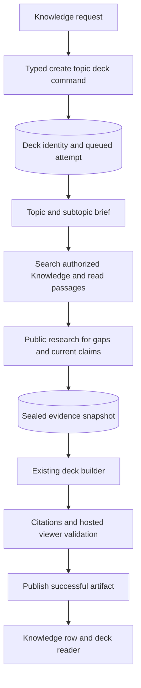

# Topic decks from Knowledge and web research

**Date:** 2026-10-04

**Status:** Proposed design. No implementation or deployment authorized.
**Scope:** Ask the Knowledge assistant to create a Learning Deck on a topic using the user's library and public web research.

Let the user type or dictate “Make me a deck about battery recycling” in Knowledge. The assistant starts a durable deck job, finds relevant passages throughout the user's Knowledge, researches the topic on the web, and builds a cited deck in the existing reader. The user does not need to select a source first.

The recommended design adds a topic source to the existing Learning Deck workflow and separates evidence collection from slide authoring within one generation attempt. It reuses the Rust worker, task ledger, sandbox, artifact validation, and reader. A versioned evidence snapshot records what the deck actually used.

## User experience

An explicit request such as “Create a deck about transformer inference, using my saves and recent research; focus on memory and latency” starts immediately. The requested topic, focus, audience, and source restrictions become the generation brief. If audience is unspecified, produce an accessible introduction followed by deeper material; do not infer the user's expertise merely from their saves. Ask a short follow-up only when the topic itself is too ambiguous to research meaningfully.

The existing Knowledge composer remains the entry point. Add “Create a deck on a topic…” to its idle examples. An optional Create Deck sheet accepts a topic through typing or dictation and offers the same command, with “Your Knowledge + web” as the default. The sheet's Create button is the submission action; a natural-language creation request needs no additional confirmation.

“What do my saves say about inference?” remains an answer/search request. Deck creation is a typed assistant action selected from the user's request, not a client-side keyword parser that intercepts ordinary conversation. Instructions inside retrieved documents cannot authorize creation or other mutations.

On acceptance, show a deck card in the conversation and an independent deck row in Knowledge. Both point to the same deck ID. The assistant can finish its response while the deck continues in the background. Reopening the app recovers the job from the server.

Progress uses durable stage information: “Searching your Knowledge,” “Researching the web,” “Building the deck,” and “Checking the deck.” Successful completion shows, for example, “Used 8 saved items and 5 web sources,” with a Sources action. Counts describe inspected evidence used in the deck, not search hits. The reader retains its existing slides, notes, and secondary chat surface.

## Meaning of the library

Working assumption: “all my knowledge” means all eligible text-bearing items in the user's Knowledge, across its supported source types. This is a corpus-wide retrieval promise, not a promise to include every item or load the entire library into a model prompt.

| Library material | What retrieval may use | Evidence treatment |
| --- | --- | --- |
| Saved articles, papers, imported documents, and other readable content | Canonical source body, metadata, and available page/section locators | Original source evidence |
| Saved podcasts and media | Available transcript with time locators | Original source evidence |
| Owned, retained Knowledge chats | User messages and confirmed assistant messages; underlying citations when available | User context or generated synthesis; not independent corroboration |
| Earlier successful decks | Readable source notes, citations, and retained teaching text | Follow original provenance; label generated material |
| Narrations visible in Knowledge | Available scripts/transcripts and original source references | Follow original provenance; avoid duplicating the original as new evidence |

Exclude inbox-only content, archived or hidden conversations, deleted artifacts, processing fragments, system prompts, internal agent logs, and another user's material. Completed items with unavailable text remain visible in coverage counts. HTML deck scripts are not a textual authority; extract inert teaching text or use source notes. Do not transcribe old audio or reprocess unavailable sources automatically as part of deck creation.

If the user chooses saved source material only, restrict the same retrieval path to the first two rows. Source modes are explicit: `library_and_web` by default, with `library_only` or `web_only` when requested. Generated items cannot create a circular citation chain, including referencing the current deck's prior run as independent evidence.

## Current capabilities and gaps

The checkout already supplies much of the execution path:

- [KnowledgeChatViewModel](../../client/newsly/newsly/ViewModels/KnowledgeChatViewModel.swift) submits authenticated assistant turns with Knowledge screen context.
- [Assistant routing](../../rust/crates/newsly-worker/src/chat_turn/routing.rs) and [tools](../../rust/crates/newsly-worker/src/chat_turn/tools.rs) expose web and library operations but have no deck creation command.
- [Deck contracts](../../rust/crates/newsly-contracts/src/learning_decks.rs) accept content, News, or a URL. Persisted sources are currently Content or GitHub repositories.
- [Task tools](../../rust/crates/newsly-worker/src/task_tools.rs) already expose Exa web search, saved-content search, authorized reads, and selected copies into the task workspace.
- [Saved-content search](../../rust/crates/newsly-db/src/chat_tooling.rs) already uses weighted PostgreSQL full-text search over titles, sources, and `search_text`. Current body excerpts are compacted to 1,000 characters, so this does not search the full original. The task tool returns at most ten results without continuation. The chat search has pagination but different readiness/visibility filters. Neither is a unified index of all Knowledge types.
- [Authorized reads](../../rust/crates/newsly-db/src/agent_library.rs) currently reference Content only and prefer rendered text over source text. The exportable library also admits chat-linked content; that export scope is not the definition of saved source material.
- [Deck generation](../../rust/crates/newsly-worker/src/learning_deck/agent.rs) already builds in E2B and validates the hosted viewer. Its prompt assumes a primary source and optional research.
- `llm_tasks` owns new attempts; `processing_tasks` owns queue execution. The legacy `learning_deck_runs` ledger remains a compatibility reader, not the owner of new work.

The gaps are topic identity, a creation tool, complete source eligibility, passage retrieval, host-recorded provenance, durable research checkpoints, and source-aware citations. A prompt-only change would leave these gaps unresolved.

## Execution and ownership



Keep this in the existing `learning_deck` task kind and `run_llm_task` executor. Research is a checkpointed preparation stage of the same attempt, performed on the host with typed tools and no sandbox. Only slide authoring and browser validation acquire E2B. It does not need its own chat session, independently scheduled research job, or second workflow authority.

`newsly-api` parses and authorizes the direct command. The chat worker invokes the same shared creation repository operation through a typed `create_topic_learning_deck` tool. `newsly-db` owns transactional deck identity, attempt creation, receipts, source eligibility, index projections, and queue insertion. `newsly-worker` owns research and generation orchestration. Existing provider and extraction adapters own web calls; the agent runtime and E2B adapters continue owning model and sandbox execution.

Each stage follows the existing prepare/work/finalize rule: copy immutable input in a short transaction, release the connection, do external work, then persist through a fresh transaction that checks user, deck lifecycle, exact lease, and attempt generation. Stage progress and research checkpoints require the same fences as artifact publication. Cancellation stops later work and publication; it does not pretend already incurred usage disappeared.

## Deck identity and command contract

Add `topic` to `LearningDeckSourceKind`. A topic deck has no `source_content_id` or fabricated source URL. Its topic brief is its explicit origin; its supporting evidence is a separate source collection. Source-based decks retain their current identity and behavior.

Add `POST /api/learning/decks/topic`, accepting a typed brief and client request UUID:

```json
{
  "request_id": "client-generated UUID",
  "topic": "Battery recycling",
  "focus": "Technology tradeoffs and current economics",
  "source_mode": "library_and_web"
}
```

Topic is required, trimmed, and bounded. Focus is optional; omitted or null means no additional focus. Request identity is required for direct commands. The assistant uses the accepted user message identity, with at most one topic-deck creation per message; a transient provider tool-call ID or model action order cannot define uniqueness. Model output cannot supply user IDs, storage paths, or scope expansion beyond the user's brief.

Keep the existing failed-attempt retry route. Add an explicit `POST /api/learning/decks/{id}/regenerate` command with its own request UUID for a fresh attempt on an existing topic deck; this must not call topic creation as a new intent. Add an authenticated Sources query for a specific successful attempt so the reader's slides and evidence always come from the same published version. Additive response fields separate active research progress from the last successful source summary. Store the topic separately from the deck's editable display title.

The assistant tool stages a typed creation intent; it does not mutate decks directly. The chat finalizer atomically persists the confirmed reply, stable deck, attempt, queue task, creation receipt, and typed deck attachment in the exact lease/stream-generation fence. Creation therefore starts at the end of this short routing turn. For direct form commands, the command transaction persists the same deck/task/receipt without a chat attachment. Cards render from durable host state, not a model's assertion that a deck exists.

Repeated tool calls for the same accepted creation intent return the same staged outcome even if the model supplies a different tool-call ID. A conflicting brief under the same identity fails explicitly. Use `topic:msg:<accepted-user-message-id>` for chat and `topic:req:<client-request-uuid>` for direct commands, scoped by user. Retain a receipt tombstone after deck deletion so replay cannot resurrect a deleted deck. Extend chat render metadata with a typed deck attachment; current feed-option metadata does not provide this yet.

A new request for the same topic creates a new deck. Retrying or regenerating an existing deck keeps its identity. Topic words are not a unique key. Existing “one active generation per user” includes research. Concurrent creation returns the existing active job when it is the same intent, or the established active-deck conflict when it is different; it never creates a second active attempt. For a chat conflict, publish a typed blocked action pointing to the active deck rather than a false creation success.

After the finalizer commits, a lost chat HTTP response or later chat cancellation does not cancel the deck. The durable receipt remains discoverable by the conversation and Knowledge list. Before that commit, chat failure, cancellation, or lease loss prevents creation. Cancelling/deleting the deck is a separate action.

## Finding the relevant saved knowledge

Use the full eligible corpus as the search scope. Decompose the topic into subtopics and search terms, retrieve passages, rank them for relevance and teaching value, and inspect the most useful originals. Include lexical variants so “battery recycling” can discover a paper that discusses “hydrometallurgical recovery” in its body without those words in its title. Relevance comes before recency; older foundational material remains eligible.

The initial retrieval design uses PostgreSQL full-text search, passage ranking, and model-generated query expansion. Add a rebuildable passage projection populated from canonical text, with these logical fields:

- Typed resource reference: kind and identity, with user scope for private resources.
- Canonical revision hash, body variant, text, and UTF-8 passage offsets.
- Heading and available page/time locator; never invent a page number.
- Search document, projection version, and readiness state.

Content passages may be shared as a projection of common source content; eligibility still comes from each user's save records. Chats, private notes, and scripts retain explicit user ownership. Filter eligibility before applying rank and limits, and reauthorize before reading a result. Do not fetch a global top set and filter another user's matches afterward.

Prefer canonical source text over editorial summaries for evidence. Summaries and rendered text can help discovery, but are labeled as derived and do not become the original citation. Read relevant sections with explicit continuation; per-read bounds are not permission to silently discard the rest of a source. Oversized or unavailable text produces a recorded limitation. Existing 20 MiB source safety rules remain in force.

Extend shared Knowledge retrieval with typed references for the supported corpus, pagination, passage locators, and coverage metadata. Reuse the eligibility/read implementation from chat and deck tools so their source definitions do not drift. Keep public Knowledge browse order separate from research relevance order.

Projection updates follow completed source-body, chat-message, deck-publication, and narration changes. Prepare chunks from immutable text outside the transaction; publish a bounded set with its canonical revision where practical, or enqueue revision-keyed projection work atomically with publication. Large documents use staged batches and become searchable only after the matching revision is complete. Reject stale writes and retire stale revisions from retrieval. Backfill existing eligible material before announcing complete corpus coverage. Deletion and archive rules must apply even while a rebuild is pending. Reconciliation repairs missed projection work; stale index rows cannot grant access. Private passage and manifest tables carry `user_id` and join the explicit account-erasure registry; session-only ownership is insufficient.

Report eligible, current-indexed, pending, unavailable, retrieved, and used counts with a retrieval timestamp. A partial index cannot justify “you have no relevant saves.” Repair relevant missing projections during preparation when practical, or report the coverage limitation. The job freezes selected source revisions, not a claim that every source was individually read.

Do not require new embeddings for the first version. The existing News lens JSONB vectors are not a Knowledge passage-search service. Measure missed synonym and conceptual matches with a library retrieval fixture first. If lexical expansion cannot meet the recall target, add semantic passage retrieval through a Newsly-owned embedding adapter and combine its rank with lexical rank. Model choice, dimensionality, provider privacy, and backfill cost are separate reviewed implementation decisions; this design authorizes no paid indexing run.

## Public research and evidence synthesis

Both source families must be attempted in default mode. Start with saved material to establish the user's existing context, then search the public topic for missing foundations, counterarguments, and recent developments. Public topic searches may overlap local retrieval once the brief is known. There is no required percentage of saved versus web evidence and no requirement to cite an irrelevant save.

Reuse the Exa adapter for discovery. Search snippets identify candidates; they are not sufficient evidence for detailed factual slides. Fetch and extract selected pages through existing Rust-owned, bounded public-network/extraction paths. Record publication time when available and retrieval time always. Prefer original papers, documentation, data, and first-party statements for technical claims. Current claims need current evidence; disagreement with an old save should be presented as a dated contrast rather than silently overwritten.

External queries contain the public topic and public subtopics. Enforce this through separate query-planning context: the public researcher sees the user's authorized topic brief and public-source text, never private saved excerpts or chat messages. Library coverage may identify gaps within the already planned public subtopics without supplying new private phrases. Record outbound queries in the research manifest. Private excerpts, personal names, and unpublished details cannot become search terms merely because they appear in the library. If the requested subject itself is private, stay within Knowledge and explain the unmet web-research requirement unless the user explicitly authorizes those topic terms. Retrieved documents remain untrusted evidence and cannot change tool authorization.

The research stage produces an outline plus supported claims. Distinguish source facts, the user's own views, and generated interpretation. Trace generated Knowledge back to its original sources where possible. Dedupe an article found both in the library and on the web; it is one evidential origin with two discovery paths. Expose meaningful conflicts and evidence gaps instead of manufacturing agreement.

## Evidence snapshot and citations

Persist a versioned `research_manifest` and evidence object keys on the canonical attempt. Use the existing attempt ledger, with a dedicated typed field/reference rather than putting unbounded research text into `source_metadata`. The research objects belong to that attempt and are included in cleanup inventories.

The host records evidence when an authorized read/fetch succeeds. Each source has a stable manifest ID, typed origin, revision/checksum, canonical URL or internal reference, title, dates, inspected excerpts and locators, and limitations. Discovery-only hits are separate from inspected sources. The agent cannot manufacture a source record by writing a URL into Markdown.

Seal the selected evidence and outline before authoring slides. The builder consumes this snapshot and writes a structured slide/claim mapping referencing manifest source and excerpt IDs, alongside `index.html`. For topic decks the host renders source notes from the manifest and checked mappings; agent-authored metadata cannot populate public deck metadata. More research requires an explicit transition back to host research, a new manifest revision, and invalidation of mappings based on the old revision. Ordinary layout repairs reuse the same evidence.

The current deck sandbox has Knowledge/web tools and broad public egress; it cannot enforce this design. The topic builder receives only selected evidence, file/execution tools, and preinstalled or host-fetched presentation dependencies. Deny network egress before private excerpts enter the VM; do not allow arbitrary curl, package downloads, or web tools during authoring. Bundle required runtime assets. Topic artifact and viewer policies prohibit arbitrary external network destinations, including connect/image/style requests from generated scripts. Reuse the hosted viewer validator with these local assets, and prove the restriction with an egress test.

Validation requires at least one inspected original source and supporting excerpts for every central factual claim; comparisons need evidence for each side. User messages may establish the user's view, not objective corroboration. Reject unknown source IDs, invalid locators, unsupported quotations, and citations absent from the host-rendered source notes. Check exact quotations against sealed text deterministically. A bounded evidence review checks central claim support and important contrary evidence; allow one evidence-repair pass, then fail unresolved material claims. Structural validity does not prove factual truth; measure claim support in fixtures and report material uncertainty. The usual artifact limits and hosted browser validation still apply after citation checks.

The Sources panel groups “Your Knowledge” and “Web research,” labels generated context, and links to saved originals or public pages. Slides use compact citations; the panel provides detailed provenance and research limitations. Research pages do not automatically become Knowledge saves or unread Briefing content. “Save this source” is an explicit ordinary content submission.

Deck chat receives the visible successful deck's evidence snapshot and teaching content, including for topic decks without a Content ID. A pending regeneration must not switch that grounding early. Explicit requests for newer information can use web tools and label their findings as subsequent research; they do not mutate the published deck automatically.

## Retries and source lifecycle

Research checkpoints survive worker restarts and lease changes but only the current lease can advance them. Key checkpoints to the canonical attempt and manifest revision, verify `deleted_at`, and reuse the existing queue retry budget. Store external operation identity where transport can be ambiguous. Reattach existing E2B execution when required by its contract; never blindly start the same sandbox command twice. Deck cancellation/deletion must cancel or wake the associated queue execution; the current deletion path updates attempt state but does not stop an already running agent. Research also checks cancellation between calls and before checkpointing.

A recovery retry reuses a sealed manifest if its format and source eligibility are still valid. If research failed before sealing, resume completed reads/checkpoints and finish the missing work. A user-requested regeneration creates a new attempt and gathers current evidence. New focus is part of that attempt. Failed research, authoring, or validation preserves the last successful artifact and its matching manifest.

Before sealing and in the publication transaction, recheck selected private-source access and lifecycle. Coordinate that final check with source removal/archive/deletion through consistent row locking or a shared eligibility generation, so revocation cannot commit between authorization and artifact publication. If a save is removed, a chat archived, or a source deleted before publication, remove that evidence and rebuild/revalidate affected claims, or fail with a clear recovery message. Do not publish an already-rendered deck based on invalidated evidence. Record immutable revision hashes so source updates cannot mix text from different versions within one citation.

After successful publication, ordinary unsaving does not retroactively erase an independently retained deck. Its evidence excerpt remains part of that deck's provenance. Deleting the deck cancels work, revokes access, and schedules deletion of research and artifact objects. Account erasure removes owned derivative evidence and index projections as well as originals. This retention rule must be visible in source notes and deletion behavior, rather than remaining an accidental storage effect.

The deck is private by default. Existing explicit sharing publishes its synthesized content, which can include information from private Knowledge. The share surface must explain that consequence. The host produces separate private and public source-note renditions: public notes include web evidence and public URLs, omitting private titles/excerpts, raw chat transcripts, complete private documents, internal IDs/paths, and private snapshot endpoints. Serving code selects the correct rendition; prompts cannot enforce this boundary. Authorized private source reads are not public share links. A successful topic-deck regeneration disables sharing atomically with publication until the user enables it for the new version; a failed rerun leaves the previously shared successful version intact.

## Failure behavior and operating limits

| Situation | Required behavior |
| --- | --- |
| Empty library or no relevant saved passages | Continue with web evidence and state that no relevant saved material was used |
| Relevant sources unavailable or projection incomplete | Continue only with adequate evidence and show specific coverage limits |
| Web research unavailable | Use the existing bounded retry policy, then fail default combined mode with an option to retry using `library_only`; do not silently change the requested mode |
| Current facts cannot be verified | Qualify or omit them; fail if freshness is central to the request |
| Evidence is too weak overall | Fail with a useful explanation instead of generating unsupported slides |
| User deletion or lease loss | Stop publication; preserve cleanup and observed usage records |
| Another deck is active | Return the established conflict with access to the active job |

Research and rendering share one absolute topic-generation deadline, with shorter stage deadlines and lease renewal. The current 300-second sandbox timeout is not evidence that a complete research-and-build job fits. Start evaluation with a proposed ten-minute total budget, allocating roughly two minutes to research, six to authoring, and two to validation; tune before release based on successful representative jobs. These are proposed operating budgets, not measured latency or a user-facing promise. Repeated research that no longer changes coverage should stop. Keep bounded search responses, page reads, artifact sizes, and sandbox operations. Do not introduce a model-request/output-token ceiling that contradicts K12. Source/passage selection budgets are fixture-driven tuning parameters, not arbitrary fixed evidence quotas.

Record research searches, fetches, model usage, and E2B usage through existing durable accounting with deck/attempt/stage attribution. Extend Exa usage recording to carry the canonical attempt ID; current task-tool records lack this attribution. Report an unknown total when usage is unpriced. Prototype evaluations can use fakes; live provider or sandbox evaluation requires separate cost authorization.

## Compatibility and rollout

Use additive fields for topic brief, source summary, coverage, and progress stage. Keep existing queued/preparing/generating/validating/publishing/terminal statuses; research substage details do not need new status enum values. Existing content and GitHub create requests continue unchanged.

The current generated Swift source-kind enum preserves unknown strings, and timeline source grouping only binds Content decks to saved Content rows. These are favorable seams for independent topic rows. They do not prove every installed app version can render topic decks: add fixtures for unknown source kinds, absent source URL/Content ID, pending topic rows, and viewer/retry/share operations. Inspect supported-client contracts before enabling topic results. If a supported client cannot handle them, filter topic results and tool access through an explicit capability during the support window; remove that compatibility when minimum supported versions and route evidence permit it. No capability gate is otherwise necessary, and no v2 route family is required solely because an open enum gets a new value.

Server presentation is stricter: `present_deck` currently turns an unknown source kind into an internal error, failing the entire list. Before writing topic rows, deploy a compatibility baseline that logs and skips only unrepresentable future kinds on list reads, while keeping known-type validation strict and giving direct unknown-kind reads a stable unsupported response. Topic-capable presentation then exposes topic rows normally. Keep any rollback at or above that baseline; deploying a fix now cannot make a still-older binary safe.

Expand schema and deploy topic-capable workers before enabling creation. Drain old writers according to the existing deployment workflow; once topic rows exist, older binaries that assume only two source kinds cannot safely own those tasks. A feature toggle stops new creation but does not make such a binary rollback safe.

## Implementation slices and validation

1. **Topic deck end to end:** first amend the relevant laws and deploy the presentation compatibility baseline. Add the direct topic form, host research, evidence manifest, restricted builder, host notes, and durable Knowledge row. Then add the assistant tool and finalizer-created attachment using the same command. Keep this a development or limited feature with explicit source-material scope until broader corpus coverage is ready. Prove duplicate acceptance, active-job conflict, cancellation, citation identity, and reader behavior.
2. **Complete Knowledge retrieval:** implement body passages and eligibility for chats, earlier decks, and narrations; backfill and reconcile projections; add corpus coverage and original-source tracing. Release the “all your Knowledge” promise only after eligible types are supported and coverage is truthful.
3. **Retrieval quality:** evaluate recall and claim support on realistic fixture libraries; add semantic retrieval only if measured gaps justify it. Broaden live validation only with authorized cost and a documented workload.

Required fixtures include a matching concept buried in a source body, a synonym absent from its title, an old foundational save, a large library beyond the first page, podcast timestamps, multilingual text/tokenization, generated context with missing provenance, conflicting sources, duplicate web/save origins, stale revisions, partial backfill, and unavailable text. Set an expected relevant-source set for each fixture and measure recall rather than checking only that a deck exists.

Persistence tests cover same-message tool replay, lost HTTP response with reused request UUID, repeated model calls with different tool-call IDs, reordered tool calls, two concurrent creates, chat failure before finalization, response loss after finalizer commit, lease loss at every checkpoint, invalidated source access, cancellation/deletion, retry versus regeneration, and a failed rerun retaining the successful manifest/artifact pair. Privacy tests place another user's highly relevant passage in the index and verify exclusion before ranking, reading, and publication. Also prove build/hosted-viewer egress restrictions, public-note sanitization, account erasure of projections/manifests, queue cancellation during research, and attempt attribution for Exa usage.

Contract and native tests cover additive topic fields, unknown enums, absent source IDs, chat attachment recovery, progress after relaunch, Sources navigation, keyboard/dictation/accessibility, and the unchanged source-based flow. Artifact tests cover source mappings and actual hosted portrait/landscape rendering. Release validation remains the canonical gate, followed by separately authorized production proof.

Before implementing the affected behavior, update K6 for explicit single-source or topic origins, K7 for intent identity and regeneration, and K21 to define explicit natural-language creation as well as form submission. Amend P17 to permit a rebuildable host retrieval projection and its durable preparation jobs while retaining the prohibition on sandbox library mirrors. Add laws for full-corpus eligibility, citations/coverage, independent handoff, source snapshot retention, and sharing. Keep architecture notes and `docs/log.md` current during implementation. This proposal does not change the current behavioral laws yet.

## Alternatives considered

| Approach | Assessment |
| --- | --- |
| Add topic origins to the current deck pipeline | Recommended. Preserves deck ownership, publication, and reader behavior while making research explicit |
| Generate a synthetic Content row as the source | Hides a topic request behind fabricated content, pollutes saves, and confuses retry identity and evidence provenance |
| Ask chat to write a report, then create a deck from the report | Adds a second generation handoff and makes a generated report appear to be the original evidence |
| Create a separate research subsystem | Useful only if reusable standalone research becomes a product requirement; unnecessary ownership and lifecycle complexity here |

## Independent review

Completed a read-only `oracle-fable` consultation through Claude Code, explicitly routed to `claude-opus-5-5` with high effort. The returned `modelUsage` confirmed that exact model. No live provider evaluation or runtime validation was run.

The review supported topic origins and one checkpointed generation attempt. Code inspection verified and incorporated these material findings:

- Existing broad VM egress and research tools would bypass host provenance and leak private context. Research now runs on the host, with an isolated public query planner and an offline builder.
- Model action ordinals are unstable across retries. Creation now uses accepted-message identity and the fenced chat finalizer, with a typed attachment and receipt tombstones.
- Current search uses short body excerpts, and source reads prefer rendered bodies. Complete passage retrieval and canonical-text reads are release requirements for the broad library promise.
- Unknown server source kinds currently fail list presentation. A compatibility baseline precedes topic data.
- Topic notes need host generation with separate public/private renditions; metadata cannot be trusted simply because the agent wrote it.
- P17 currently prohibits the proposed index; the law change is explicit. Topic chat grounding, cancellation of queue work, account-erasure ownership, deadline sizing, and usage attribution also require scoped changes.

Two advisory recommendations were intentionally not adopted. A second confirmation card is unnecessary for an explicit human request to create a deck; K21 will distinguish explicit requests from ordinary questions. Generated Knowledge remains eligible in the complete design because it is part of the requested library, but is labeled as context, traced to originals, and prohibited from counting as independent corroboration. It remains outside the initial limited source-material slice. These choices are documented product decisions, not claims about existing behavior.
