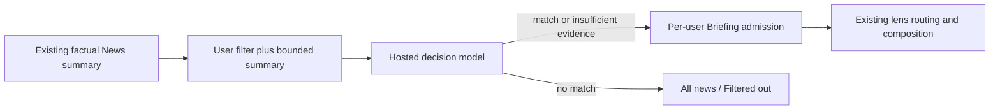

# Summary decisions from user-written filters

**Implementation update (October 17):** The implemented scope below supersedes proposed decision slots, generations, separate evaluation tasks, deadline reconciliation, active revision pointers and collection-version cursors in this research design. See the current [architecture](../architecture.md#personal-news-filtering) and Briefing laws. Inference runs within the existing refresh lease, successful outcomes are immutable cache entries, and bounded failures use pending admission provenance. Existing publication is preserved; All News is a live keyset collection. Product code is now implemented locally; release and production verification remain separate.

Status: proposed design, created 2026-10-16; updated 2026-10-17 for onboarding bootstrap, Settings placement, and News-only scope. No implementation or model benchmark has run.

## Decision

Replace the global editorial `to_read` / `skip` judgment with a **per-user decision over the factual summary and the user's written filter**. Use a hosted pretrained decision model directly, comparing TypeSafe Jev, Cloudflare Clef, and hosted Kev. No labeled training set, fine-tuning, embedding classifier, or implicit learning from reading history is required for the first version.

The user supplies the preference; the model applies it. For example:

> Include technical AI research and practical engineering lessons. Exclude funding announcements, launch marketing, and opinion pieces without concrete evidence.

The existing summarizer should describe the source, without deciding whether anyone should read it. A separate decision answers whether this summary satisfies this user's filter. The same shared story can match one user's filter and fail another's.

Confirmed v1 scope: one optional account-level filter applies **only to News** in Briefing. Articles and Podcasts are deliberately opted into and arrive less frequently, so they bypass preference evaluation and its waiting/budget rules entirely. Their ordinary readiness, ownership, and read/archive rules still apply. Do not ship content-kind switches in v1. A later extension may offer News / Articles / Podcasts toggles, defaulting to News only, but that is deferred. No per-topic overrides, multiple-filter Boolean editor, autonomous preference updates, or recommendation score. A blank or disabled filter admits everything otherwise eligible. Matches keep existing chronological/diversity ordering.

This supersedes the previous research recommendation to collect personal training labels or enforce the old editorial flag first. A pretrained model avoids that setup burden. It does not establish accuracy without evaluation: test instruction-following and inspect a small preview, rather than asking the user to label hundreds of stories.

## Product behavior

**Settings → News filter** is the primary editor. Give it its own compact row immediately below the brand header, above Library and Account; retain any urgent account/connection banner above the header. Show an enabled/off status and a one-line excerpt of the saved instruction, or “Choose what news appears in your Briefing” when unset. Use the existing Settings row/card styling. Opening the row shows a multiline field labeled “What news are you interested in?”, an enable switch, **Preview**, and **Apply**. Explain “Applies to News only. Articles and Podcasts are unaffected.” Briefing's filtered/empty-state Edit action opens this same editor, not a second preference surface. The current placement seam is [SettingsSectionStack](../../client/newsly/newsly/Views/Settings/SettingsSectionStack.swift).

The original user text is the canonical instruction; do not silently rewrite it through another model. Accept up to 8,000 characters, matching the existing onboarding transcript limit, with an additional 8,192-token policy ceiling validated using the selected provider's tokenizer or a conservative bound. These replace the earlier 2,000-character/512-token proposal so ordinary onboarding input can be reused intact. Keep the full request within the selected provider's limit with source/schema headroom; longer instructions increase billed input. Never truncate a preference, since that can remove a negation or exclusion. The storage limit is 8,000 characters; the inference token ceiling gates activation separately. If a stored draft exceeds the verified token bound, retain it disabled for editing and ask for shortening before activation; do not silently activate a different instruction or block completion of onboarding. New edits above the storage limit return a field validation error.

### Bootstrap from onboarding

Use what the person actually says they are interested in during personalized onboarding: their submitted text or the final speech transcript used to start discovery. Preserve that text on the owned discovery run, then copy it into the initial filter revision when that run is completed. Interpret interest statements such as “I'm interested in AI research and distributed systems” as inclusion criteria; preserve explicit exclusions. Source-subscription requests remain discovery inputs, not commands to the evaluator. Do not substitute inferred topic tags, feed selections, or the planner's generated summary for the person's wording. If the input supplies no usable news preference, the evaluator returns uncertainty rather than inventing one.

Show the seeded text as an editable **News filter** summary in the existing onboarding completion screen, with concise copy that it will filter News and can be changed later in Settings. Enable a nonblank valid seed by default; the user can edit or turn it off there without a separate mandatory preview, labeling step, or additional model call. Persist the exact displayed/edited text. The ordinary completion action applies it. If onboarding is skipped/non-personalized or no interests are supplied, leave filtering off and expose the empty Settings row.

The inspected [onboarding API](../../rust/crates/newsly-api/src/onboarding_flow.rs) passes the transcript to the planner, but `audio_run_input` currently carries only generated `topic_summary`, inferred topics, and lanes into [run persistence](../../rust/crates/newsly-db/src/onboarding_flow.rs). Retaining the original text and accepting an optional edited seed/enabled state in the completion contract are required new work. Expose the server-stored original text through the authorized discovery status response so the completion screen can restore the exact seed after an app restart. The new native client submits an explicit text and enabled state from that screen. Omitted filter fields on an old client create a disabled seed from stored original text, not an automatically enabled filter the client cannot show or edit. Agent onboarding also stores its supplied brief as a disabled seed by default, with provenance identifying it as an agent brief; do not claim that generated agent prose is the person's verbatim statement. Explicit agent activation requires a versioned completion contract carrying the intended text and enabled state, under the same product capability gate as native activation. A preexisting run without original input remains unseeded. Do not infer a historical raw statement from generated summaries.

Define completion input as an optional seed object: omission means the disabled compatibility seed; a present object requires both `text` and `enabled`; explicit null or missing members are invalid. An explicit blank text normalizes to disabled and creates a durable revision, while `enabled: false` preserves any supplied text in a disabled revision. Turning the seed off or exceeding only its inference-token limit still writes that disabled revision, so later onboarding cannot reset the choice. Non-personalized completion (`discovery_run_id: null`) rejects seed fields and creates no filter row. A preexisting personalized run without retained text may still accept an explicitly entered valid seed through the new UI; it must not fabricate a default.

Create revision 1 and its active pointer in the existing onboarding completion transaction, before first-edition preparation and refresh tasks are made visible. Initialization is create-if-absent under the same per-user locking/uniqueness boundary as Settings writes. Retries, resumed discovery, and later onboarding runs cannot reset an existing preference, including a deliberately disabled or cleared one. When a preference already exists, preserve it and direct intentional changes through the normal revision-checked editor. A Settings save racing onboarding wins as an explicit edit or returns a revision conflict for reload; it is never silently overwritten by the seed. No provider call runs in this transaction.

Existing onboarded accounts are not silently opted into filtering using old inferred topics. They get the Settings row and can enter their preferences; new personalized completions bootstrap automatically. Onboarding is a one-time seed, not a second live preference owner: subsequent changes to discovery topics or subscriptions do not alter the active filter. Store `origin` (`onboarding` or `settings`), onboarding input kind (`typed`, `speech_transcript`, or `agent_brief` when applicable), and a nullable source run ID on each revision for provenance; Settings owns subsequent edits, and the active text does not depend on retaining the discovery run.

### Preview and application

Preview checks up to 20 upcoming eligible, unread, unpublished News candidates from the same bounded pool admission examines, and shows the title, summary, result, and a fixed explanation of the outcome. It uses the same evaluator and decision thresholds as production. No rating exercise is required. Editing the instruction and previewing again is the primary correction loop. Preview does not change the active filter, Briefing, or read state.

Proposed API surface: `GET/PUT /api/briefing/filter` for the active text/enabled state and expected revision; `POST /api/briefing/filter/preview` for an unsaved draft and a bounded server-selected sample; and an authorized News source-list query with an optional filtered-out selector. V1 has no user-configurable content-kind field: the server enforces News-only scope. Preview can be a bounded request: load authorized owned projections, release the DB connection, call the evaluator with limited concurrency and a total deadline, then return completed decisions plus explicit unavailable entries. It needs no draft-revision database workflow and never writes production decision slots. Allow one active preview per user, at most two concurrent provider requests within it, and a 15-second total deadline. Use a shared provider rate limiter with production admission taking priority and reserved capacity; return a busy response instead of letting Preview exhaust the organization quota. Record ordinary usage, cap previews at 200 evaluated sources per user per day, cancel remaining work on deadline, and require the UI to discard results whose draft hash no longer matches. Feed reads remain model-free. A failed preview does not save or enable its draft.

Apply creates a new immutable filter revision. UI copy states: **“Applies to upcoming News additions in your Briefing. Existing passages stay in place.”** Reevaluate unread, not-yet-published News candidates under the new revision in bounded background batches. Already published passages, citations, read state, and existing audio programs remain stable. Disabling the filter releases eligible unpublished candidates for ordinary admission without rewriting earlier editions.

Add **All news** as an accessible collection inside Briefing, with an optional **Filtered out** selection. It lists accessible News cards directly, without generating Briefing prose for excluded items. Items remain openable, saveable, and usable for Chat/Deck creation through existing authorized source actions. A filtered-out item is not read, archived, deleted, or globally skipped. A clear empty state shows the filter and offers Edit or All news; there is no silent relaxation when nothing matches.

This is new UI: the inspected app shell has Briefing and Knowledge, not an established All-News screen. All news must provide an actual authorized News collection and source actions; Articles and Podcasts need no new filtered collection for v1.

## Decision semantics

The provider returns a typed choice and option probabilities. Our normalized result separates the raw model choice from the effective product decision:

```json
{
  "model_choice": "no_match",
  "probabilities": {"match": 0.03, "no_match": 0.94, "insufficient_evidence": 0.03},
  "effective_decision": "no_match",
  "reason_code": "filter_not_matched"
}
```

The numbers are an illustrative response, not measured accuracy. `model_choice` and `effective_decision` values are exactly `match`, `no_match`, or `insufficient_evidence`. These decision models do not generate a free-text reason. UI explanations come from fixed messages: “Matches your filter,” “Does not match your filter,” or “The summary does not provide enough evidence,” alongside the original filter and summary. Do not invent a specific justification, quotation, or evidence span.

Use a three-way Choice question with precise definitions. Persist the option probabilities. TypeSafe confidence is a derived statistic of that distribution, not an independent correctness signal; the core contract does not require a separate confidence field. As a conservative initial policy, only hide when the choice is `no_match` and its option probability is at least 0.90. Otherwise downgrade a weak exclusion to `insufficient_evidence` with reason code `low_decision_certainty` and UI copy “Not certain enough to hide.” This differs from the model choosing insufficient evidence, whose reason code is `summary_insufficient`. This provisional threshold is versioned and must be checked against rule-following cases; it is not a promise of 90% accuracy, and vendor calibration does not establish Newsly calibration. [Choice contract](https://docs.typesafe.ai/primitives/choice), [confidence distinction](https://docs.typesafe.ai/confidence).

| Result/state | Upcoming News behavior in Briefing | All news behavior |
|---|---|---|
| Filter disabled | Ordinary admission | Visible; filtering off |
| `match` | Ordinary admission | Visible; matched |
| `no_match` | Excluded from new composition | Visible under Filtered out with the active filter |
| `insufficient_evidence` | Included conservatively | Visible; fixed explanation distinguishes missing evidence from low certainty |
| Decision pending | Other ready items proceed; bounded wait for this item | Visible; checking filter |
| Timeout/invalid output/service unavailable | Include conservatively after bounded wait; show degraded filter status | Visible; filter unavailable |

Start with a two-minute maximum per-source admission wait, measured from the current revision's queued evaluation. This is a product latency budget to validate, not a model speed estimate. Worker wakeups and a deadline reconciliation path must resolve it even if inference workers are offline. Expiry produces a distinct operational outcome (`unavailable`), not a fabricated model result. Inference and deadline finalizers serialize on the same decision identity: first terminal result wins, and a late provider completion cannot overwrite an unavailable decision. Retries do not reset the deadline. Alert on sustained degraded filtering rather than presenting it as successful filtering.

Include uncertain items so a short summary or outage cannot silently erase useful material. The UI explains this default. If strict exclusions are later required, make that a deliberate separate product policy; do not infer strict enforcement from the model's numeric score.

Clearly off-topic summaries are `no_match`: “only AI research” excludes a summary about a football match. Missing evidence about originality or depth is different from an obvious topic mismatch and yields `insufficient_evidence`. Explicit exclusions take precedence when the summary supports them. With an exclude-only filter, include when the summary supplies enough information and no exclusion applies. Ambiguous or contradictory instructions yield `insufficient_evidence`; Preview should expose these cases. The model must not use remembered facts about the source to fill missing evidence.

Requests such as “only original studies,” “nothing I already know,” or “high-quality reporting” may require evidence absent from a short summary. V1 does not retrieve full text, fetch URLs, inspect personal history, or call tools to resolve them. It cannot reliably enforce such criteria when evidence is absent. The UI should say the summary is insufficient; it cannot name the missing evidence without a separately supported explanation mechanism.

## Placement and input



Evaluate News after its shared summary is durable and before adding it to per-user Briefing pending work. Dispatch by the actual source kind before any decision lookup, enqueue, or wait: Articles and Podcasts proceed through ordinary admission. Filtering scope is the News tier, not whether a title sounds newsworthy. A saved Article is not filtered merely because the same URL also appears as News; preserve the existing canonical identity/readability rules. Never write a per-user result onto the shared source row. Keep subscriptions, ownership, archive/read state, canonical representative reconciliation, and source readiness as independent authoritative gates.

The source input is a versioned projection: source kind, title, source name, factual summary, key points, and explicitly present publication metadata. No existing classification, inferred user taste, raw HTML, images, source transcript, comments, URLs to fetch, or another item's text. The saved preference text, which may originate from an onboarding speech transcript, is a separate input. Reuse the existing `source_from_news` summary normalization, taking only decision-relevant fields and adding a verified input bound; do not feed arbitrary metadata JSON. Do not mislabel ingestion-time fallbacks as actual publication dates. Start with a 1,024-token source budget. Persist the exact projection hash, adapter version, and whether any representation was shortened. If shortening removes the evidence needed for a decision, return uncertainty instead of manufacturing a confident exclusion. News summaries already have compact limits; verify projection coverage against the saved News schema. No long-form projection or Content decision cache is required in v1.

The prompt separates evaluator instructions, user filter text, and untrusted source data. Source text is evidence, never instructions. Use the decision-only endpoint with no tool execution. Validate complete answer IDs, allowed choices, finite probabilities, bounds and normalization in Rust; schema validity is not semantic correctness. Keep inputs well below provider limits so provider truncation cannot silently change the question. Do not put a provider call in a feed HTTP request or a database transaction.

Important existing seams are [summary generation](../../rust/crates/newsly-providers/src/news_item.rs), [Content/News admission](../../rust/crates/newsly-db/src/briefing_refresh/preparation.rs), [source projection](../../rust/crates/newsly-db/src/briefing_refresh/sources.rs), and [publication validation](../../rust/crates/newsly-db/src/briefing_refresh/publication.rs). Implement one shared News-only per-user decision lookup across normal refresh, onboarding, full rebuild, and publication revalidation; a full rebuild must not bypass News filtering or introduce filtering for Articles/Podcasts.

## Hosted model choice

Recommend **Jev as the first integration, Clef Flash as the direct managed challenger**, and Clef full as a quality comparator. Keep Kev as the option for owning a hosted model later. This order reflects integration/operations cost and published interfaces; no Newsly accuracy or latency winner has been measured. One provider is active in production, behind a small typed Rust gateway; comparison adapters belong in the offline evaluation harness until they earn deployment.

| Option | Hosting and verified interface | Published input price / million tokens | Design role |
|---|---|---:|---|
| Jev | TypeSafe through OpenRouter Decisions, runtime instructions and Choice criteria | $0.042; output free | Selected route: `typesafe/jev-1.14`; verify returned revision `typesafe/jev-1.14-20261014` |
| Clef Flash | Cloudflare Workers AI, 9B, typed decision API | $0.038; no output charge | Main managed cost/quality challenger |
| Clef | Cloudflare Workers AI, 27B, typed decision API | $0.24; no output charge | Larger quality comparator |
| Kev | `jaredpalmer/kev` pretrained checkpoints; documented deployment to our own Modal HTTPS endpoint | GPU runtime and infrastructure, not a verified managed token tariff | Later ownership/customization option; no fine-tuning required to use pretrained weights |

Sources checked October 16, 2026: [TypeSafe models](https://docs.typesafe.ai/models), [Clef Flash](https://developers.cloudflare.com/workers-ai/models/clef-flash/), [Clef](https://developers.cloudflare.com/workers-ai/models/clef/), [Kev project](https://github.com/jaredpalmer/kev), [Kev hosting documentation](https://github.com/jaredpalmer/kev/blob/main/skills/kev-deploy/SKILL.md). Here Kev means Jared Palmer's project; a separate Iluvatar Labs conversion framework shares the name and is not the proposed pretrained alternative.

Jev's docs explicitly support adapting behavior through state, instructions, and criteria without per-customer fine-tuning. The October 17 user-selected route is [OpenRouter Jev 1.14](https://openrouter.ai/typesafe/jev-1.14), with an explicitly verified dated response revision and provider; this supersedes the earlier direct 1.13 proposal. This supports the no-training-labels approach. [TypeSafe models](https://docs.typesafe.ai/models).

Send one bounded source as `state` and a Choice question defining match, no match, and insufficient evidence against the exact user filter. The documentation describes a similar System One request shape across these options, but the adapter must validate each real HTTP/response contract rather than assume byte-for-byte compatibility. Use a direct Rust HTTP adapter: TypeSafe's `/v1/systemone`, or Cloudflare's account-scoped Workers AI REST endpoint. No Python gateway, Cloudflare Worker, new GPU host, or text-generation service is necessary for the managed options. [TypeSafe API](https://docs.typesafe.ai/api), [Cloudflare REST example](https://developers.cloudflare.com/workers-ai/models/clef/).

Keep questions narrow. V1 supports a short coherent include/exclude instruction. Complex multi-stage logic is not silently compiled by an LLM; preview exposes ambiguity. If testing finds the compound judgment unreliable, present explicit include/exclude clauses for the user to confirm and evaluate independent questions, combining them in Rust. Question outputs cannot depend on one another within a parallel call.

Store requested model, returned version when available, provider, request/question schema version, projection version, threshold policy, and deployment generation. Clef's documented model IDs do not establish immutable provider revisions. If a provider offers no version pin, record that limitation, run a fixed drift probe, and deliberately bump our evaluator generation after reviewing changed behavior. There is no daily expiry: stored exclusions remain effective while a same-policy drift recheck is pending, and a failed drift recheck cannot replace them with an unavailable/include result. A changed filter or summary is different: its old decision is no longer applicable. Pin Kev's checkpoint and serving revision if adopted. Even a pinned hosted model can be retired; treat that as an explicit provider migration, not a promise of perpetual availability.

Kev's hosted path is our deployment of a vendor runtime, with cold starts, GPU-time billing, authentication, and maintenance. Its Python serving implementation is a third-party pure inference dependency; adopting it requires explicitly documenting that runtime exception, with no Newsly database or workflow ownership. It is not the same operational offer as calling Jev or Cloudflare. No deployment is part of this design.

Rust retains authentication, policy, durable state, queue ownership, usage, and failure handling. Send only the summary projection and necessary preference text to the selected provider, omit user identifiers and unrelated personal history, and redact payloads from ordinary logs. Check the selected account's data-handling terms before launch; do not equate “not trained on requests” with zero retention. Credentials stay server-side. Provider errors use the declared unavailable path; no automatic cross-provider fallback or extra judge call.

## Durable state and races

Use the existing PostgreSQL task queue; do not introduce a second workflow engine.

- **Filter revisions:** immutable rows containing user, revision, enabled state, exact instruction, origin (`onboarding` or `settings`), nullable onboarding input kind and source run ID, and creation time, with one active revision pointer. Scope is fixed to News in v1; no mutable per-kind settings or extra flags are needed. Save with an expected revision to reject concurrent lost updates.
- **Decisions:** one current slot per user and canonical News source key (`news:<id>`), containing the filter revision, summary-projection hash/version, evaluator version, evaluation generation, raw choice/probabilities, effective result/reason code, outcome origin, and evaluation time. Changing a semantic input increments the generation atomically; an old-filter or old-summary result is inapplicable. A same-policy evaluator migration retains the last effective result until successful replacement, with the recheck generation tracked separately from effective provenance. Tasks carry that exact identity and generation; stale jobs cannot overwrite the slot. Published coverage stores a compact copy of its admission provenance rather than depending on a mutable current decision. Separate “model said uncertain” from “evaluation unavailable.” Queue rows own leases/retries rather than duplicating a second task state machine here.
- **Evaluation task:** references that immutable identity. Prepare authorized input in a short transaction, release it for inference, then finalize under the exact lease. Recheck active user, current ownership, source/representative identity, active filter revision, projection hash, and evaluator version before making a result effective. A stale result never becomes the current decision.

Summary updates and filter edits invalidate decisions by identity, not by reinterpreting old results. Evaluator changes create a new evaluation identity while retaining the same-policy effective result until a successful replacement. Disabling the filter invalidates old in-flight exclusions immediately. Publication locks/checks the active filter revision and effective decision generation in addition to existing Briefing/pending-row fences. A settings-only edit need not bump the visible edition's B7 version. Removing an excluded pending row happens atomically with the effective result. Checking revision is still necessary: pending-row deletion alone cannot fence the interval after a filter edit but before reevaluation completes.

Filter Apply never invokes Full mode. An explicit maintenance full rebuild may recompose text under its existing separate semantics, but it preserves the union of still-readable previously published coverage and newly admissible unpublished sources. It cannot apply the new filter to the former and silently erase them. Compaction and narration use source readability, not current admission preference. Keep these two predicates separate in seeding and finalization even where current code shares the source loader. Full mode currently has unbounded News seeding: implementation must add bounded preparation for newly evaluated candidates and cannot retire old coverage until the complete replacement is ready; this is required new work, not an existing guarantee. Persist the admission revision/outcome reference with pending and published coverage so outage admission and later rebuilds remain explainable.

Evaluate on demand during bounded Briefing preparation, using existing refresh triggers after summaries, subscription changes, or filter edits. No filter means no model call; Articles and Podcasts never consume this evaluation budget or wait on its decisions. Do not add a separate ingestion-times-users inference fan-out. Proposed automatic evaluation window is the past 7 days for News only, using publication time or first ingestion time when publication is absent; older items remain accessible in All news as “outside the automatic window.” Start with a candidate examination budget of 128 News sources per refresh, separate from the existing News admission batch of 40, and a daily cap of 500 evaluations per user (UTC accounting). These are explicit proposed defaults, not measured optimal settings. Known exclusions do not consume the matching admission quota; continue in subsequent bounded passes beyond an excluded first window. A refresh can publish already-decided siblings while evaluation is pending. A filter edit reexamines both previously matched and excluded unpublished candidates inside that window. Old-revision slots are undecided, never inherited as matches or exclusions, and cannot enter Briefing until examined. Only actually enqueued work gets a deadline. Outside-window and daily-cap-deferred items remain in All news with explicit status; they are not timeout admissions or model exclusions. Defer further work until the next budget window and settle first-run progress as deferred so a budget stop cannot hang onboarding. Bound catch-up rate so retries or filter edits cannot launch an unbounded paid sweep.

Create the decision slot/generation and evaluation task atomically and schedule a refresh for its actual first-queued deadline. Do not derive deadlines solely from old publication or policy timestamps: historical candidates would otherwise bypass evaluation immediately. Reuse queue coalescing and reconcile due deadlines from the scheduler so an inference outage cannot leave them stuck. Different users' results never share a cache entry, even if their prose matches. Evaluator migrations recheck on demand only while unpublished and retain same-policy prior results on provider failure; no timer alone reintroduces previously excluded stories.

Filter changes recheck unpublished News pending rows before composition; excluded rows leave the composition queue but remain discoverable in All news. A later filter revision can admit them without marking them unread or replaying published coverage. Initial-onboarding News items receive an explicit per-run filtered outcome so exclusions settle progress rather than leaving the frozen cohort permanently preparing. Uncertain/unavailable items can continue through ordinary preparation. Filtered items are not processing failures.

All news reuses the existing News chronological cursor; no content-kind selector or merged cursor is needed in v1. Filtered-only lists join current News decisions through the same authorization and readiness predicates, and bind cursors to user, active policy revision, and decision collection version; increment that collection version transactionally whenever current effective decision, policy, source membership/readiness, or canonical identity changes the filtered list; stale cursors request a reload. Existing Briefing B7/B8 fixed-version paging remains unchanged because already composed segments are not reranked. Account deletion removes policies, decisions, and queued work through the existing deletion lifecycle.

## Removing `to_read` / `skip`

Remove the old editorial concept throughout the product, rather than keeping it as a second veto or a training target:

1. Remove the instruction, `NewsClassification`, generated classification field, new writes, and classification-dependent summary decoding. Existing saved summaries remain reusable; ignore their legacy classification without resummarizing them.
2. Remove editorial classification gates from Content/News feeds, Briefing eligibility and pruning, onboarding/progress, search, source statistics/history, direct retrieval, deck source access, and image eligibility/recovery. Removing the global editorial gate still covers Content as well as News; this does not opt Articles or Podcasts into personal filtering. Previously gated, otherwise ready legacy sources may consequently become eligible for existing accounts whose personal filter is off. This is an intended consequence of retiring the global veto, not a reason to silently enable a personal filter; make the working Settings editor available with that change. The inspected gate in `seed_recent_news` is on legacy `contents` rows, so do not describe all current canonical News as previously classification-filtered. A preference exclusion applies only to a user's upcoming News additions in Briefing; it must not restrict otherwise authorized direct access or Knowledge.
3. Audit all old skip rows before migration. Missing/failed summary, missing artwork, archive state, and source-type routing remain distinct lifecycle facts. Do not turn old skip rows into completed sources or mass-enqueue paid historical repair merely by dropping the field. Surface not-ready legacy items through existing processing status; normal explicitly requested retry can repair them.
4. Remove database classification columns only after every running API/worker version stops reading or writing them. This is a rolling-deployment expand/contract boundary, not dual filtering. Historical raw JSON may retain inert keys until ordinary archival cleanup.
5. Installed generated clients decode the optional-valued `classification` key as present. During the compatibility window, public responses retain that key with `null`, never an inferred personal decision. Regenerate current contracts and clients; remove this wire-only field and its deprecated type after the minimum supported client version no longer requires the key. API owns this temporary shim, and it has no policy authority.

The inventory must use behavior, not a blind rename: URL/content-type classification and `reason_to_read` editorial prose are different concepts. Current readers include [Content feeds](../../rust/crates/newsly-db/src/content_feeds.rs), [onboarding](../../rust/crates/newsly-db/src/onboarding_flow.rs), [first-edition progress](../../rust/crates/newsly-db/src/first_edition_progress.rs), [X image readiness](../../rust/crates/newsly-db/src/x_sync.rs), [summary image fan-out](../../rust/crates/newsly-worker/src/summarization/fanout.rs), [admin eval exports](../../rust/crates/newsly-admin/src/evals.rs), [feed history](../../rust/crates/newsly-db/src/feed_history.rs), [scraper stats](../../rust/crates/newsly-db/src/scraper_stats.rs), and [public DTOs](../../rust/crates/newsly-contracts/src/content_read.rs). Operator processing statistics retain lifecycle skipped/failure states, while per-user filter exclusions have separate counts; do not combine them into a global source status. The verified News-open/Content-ID analytics mismatch must be corrected when wiring these new source lists, rather than propagating it through new call sites.

## Validation, cost, and rollout

No user training dataset is a prerequisite. Build a small developer-owned behavioral suite: include-only, exclude-only, negation, conjunctions, conflicting instructions, missing evidence, non-English summaries and interests, News projection, injected instructions in source text, and deterministic schema failures. Add anonymized/authorized real summary examples and compare decisions against the written rule. These are acceptance checks, not a claim that synthetic examples prove personal usefulness. Offer the user the 20-item Preview; corrections are optional and do not silently retrain anything.

Before enabling exclusions, measure output validity, incorrect exclusions, uncertainty rate, option-order sensitivity, repeatability, end-to-end latency, rate limits, and actual billed tokens. Self-hosted Kev additionally needs cold-start, memory and sustained-throughput measurements. Inspect every exclusion in the initial preview/replay. Test two users with opposing filters on the same News source; Articles and Podcasts bypassing lookup, provider calls, waits, and caps even with numeric IDs equal to excluded News; exact onboarding text/negation preservation; typed and spoken seeds; displayed edits and opt-out; skipped onboarding; missing original input; over-limit drafts; initialization before first refresh; omitted/null/blank/disabled seed contract cases; old-client and agent disabled defaults; app restart restoring the seed; completion retries and a Settings save racing initialization; deliberate disable/clear surviving later onboarding; filter/summary changes during inference and composition; lease loss; stale retries; cancellation/account deletion; canonical merges; missing summaries; provider outage/rate limits and deadline wakeups; full rebuild/onboarding parity; disabling; progress settlement; and old-client decoding.

Cost is one short decision per user/source/current-input identity, cached until a meaningful input changes. A filter edit incurs bounded re-evaluation of unpublished candidates, not a full-history resummary. Preview is explicitly rate-limited and capped. Reuse existing usage instrumentation with a distinct operation and record cache hits, input/output tokens, latency, unavailable decisions, and queue age. For illustration, 10,000 user-item evaluations at 700 billed input tokens each cost about **$0.294 on Jev, $0.266 on Clef Flash, or $1.68 on Clef**. This is arithmetic using published rates, not measured Newsly usage; include the summary, filter, instructions, criteria, retries, and rechecks in token accounting. Cloudflare free allocation and any required account plan affect the actual bill. [Cloudflare billing](https://developers.cloudflare.com/workers-ai/platform/pricing/).

The original preliminary replay proposal, superseded for Jev by the completed October 17 evaluation below, was 60 source/filter cases on Jev, Clef Flash, and Clef: 180 requests, no paid LLM judge. At an illustrative average of 2,000 billed input tokens per request and no automatic retry, estimated published inference charges are about $0.039 before plan fees. Include long onboarding preferences in the suite; they can exceed that average, so size the actual replay budget from its full requests. Provider tokenization of instructions and criteria must be verified, then actual usage metered; the token estimate is not a guaranteed bill cap. Set a $1 metered-inference stop cap and stop if billing cannot be measured; launching Kev is separately budgeted because token arithmetic cannot cap GPU uptime. This is a proposed experiment only, not executed or billed in this task. A developer checks outcomes against the written criteria, and the user can optionally inspect Preview. No large personal labeling workload is needed.

This does **not** save extraction or summarization costs: decisions run afterward. It can avoid composing/narrating sources excluded from a user's Briefing. It does not fix source discovery truncation or recover never-ingested stories; those remain a separate ingestion issue. Do not claim “everything was filtered” when only admitted source candidates were available.

Deliver three coherent slices. Keep user-facing Apply, onboarding activation, and the Settings row behind the same capability gate until slice 3 is functional for the supported client. Slices 1–2 use developer previews and shadow decisions only; they must not promise active filtering or accumulate enabled customer revisions for a surprise later activation. At launch, existing accounts remain off until an explicit save; new supported onboarding completions can enable their displayed seed.

1. Implement the canonical News summary projection and typed hosted evaluator, the dedicated Settings row/editor, a bounded read-only Preview, and the rule-following tests. Keep the live edition unchanged while provider behavior and billing are measured.
2. Implement onboarding text retention and one-time bootstrap, revisions, durable News decisions, failure deadlines, All news/Filtered out UX, and shadow comparison on real upcoming candidates. Validate News filtering, Article/Podcast bypass, onboarding initialization, and lifecycle races; update laws/architecture as part of implementing the intended behavior.
3. Activate per-user News admission across normal refresh/onboarding/rebuild, retire editorial classification gates/writers, and complete staged wire/database cleanup. Expose the Settings row and supported onboarding editor together with working admission. Do not enable hiding before All news access and reliable progress settlement exist.

Implementation updates Briefing B2/B6/B9/B15, processing/reliability laws, contracts, native UI, and architecture to distinguish source readiness, per-user decisions, published coverage, and recoverable exclusions. The laws remain unchanged during this design-only task. Run focused Rust/SQLx concurrency and policy tests, formatting and warning-denied Clippy, contract regeneration/drift checks, and Simulator validation of onboarding bootstrap, near-top Settings placement, edit/preview/apply/filtered News access, and unaffected Article/Podcast admission before handoff. Production release, paid evaluation, account setup, and any Kev deployment remain separate actions.


## Review record

The October 17 update received a targeted read-only review with `claude-opus-5-5`; returned model usage contained only that model. Incorporated corrections cover old-client/agent disabled seeds, server-restored seed text, explicit absent/null/blank/disabled semantics, durable opt-out, over-limit activation, and gating the UI until filtering works. The News-only scope and Settings placement were checked against the current repository.

The first independent read-only review completed on `claude-opus-5-5` at high effort. The follow-up review also invoked `claude-haiku-5-5`, as shown by returned model usage; it was not an exclusively Opus run. Material code and provider claims were checked directly. Incorporated corrections include separate admission/readability predicates, onboarding settlement, actual-queue-time deadlines, bounded on-demand evaluation, required-nullable installed-client compatibility, fixed explanations for uncertain decisions, and stable exclusions during same-policy provider drift. A reported inconsistency involving `selectedModels` was not reproduced in the directly inspected TypeSafe Choice page and is not used as a design premise.

No product code, production state, model accounts, or deployed services changed. Hosted rates are documentation-verified; model quality, actual usage and account-specific access remain untested. The October 17 user direction supersedes the earlier all-kind assumption: bootstrap from onboarding interests, edit through a dedicated row near the top of Settings, and apply only to News in v1. Optional Article/Podcast switches are deferred.

## October 17 evaluation update

The [completed News evaluation](2026-10-17-news-filter-evaluation-run.md) used OpenRouter `typesafe/jev-1.14` (verified response revision `typesafe/jev-1.14-20261014`), not the original proposed direct 1.13 route. All 8,000 decisions across 1,000 production stories cost $0.254 including smoke and retries. Structured text at threshold 0.50 won the frozen development selection and held 97.2% relevance recall / 85.1% admission precision on recent held-out pairs, but ordinary prose had identical aggregate counts and no clear statistical disadvantage. These are results against Opus reference judgments on an enriched benchmark.

Keep the onboarding-seeded, editable plain-language filter and the News-only scope. Do not add a compiler or require JSON editing based on this experiment. Keep the proposed conservative 0.90 product threshold pending human audit and a naturally arriving News shadow trial; the more aggressive research winner is not an automatic product-policy change. At 0.90 the structured test removed 72.4% of irrelevant pairs with no observed relevant misses, which is finite-sample evidence rather than a guarantee. Climate and sports recall at 0.50 and sparse positive support require further evaluation. No model training is needed to start; reference labels are for evaluation, not a required content-labeling workflow for every user.
