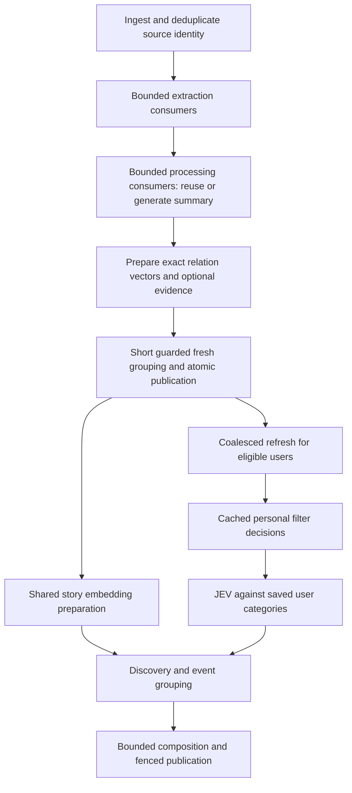

# Content pipeline performance plan — 2026-10-18

Status: implemented locally with the amendments below; production rollout and live-provider SLO validation remain separate. Target: up to 100 daily active users, confirmed by Willem. Current checkout: `main` at `5a5b75cddfb8eb16c8f33f910af7cd618c6732f6` plus substantial uncommitted work, including JEV routing, filtering and onboarding changes. This plan does not establish deployment or production readiness.

## Recommendation

Keep Rust, the existing PostgreSQL queue, and the current feature boundaries. Separate extraction capacity immediately, then enable concurrent summary/relation preparation behind safe grouping publication. Scale Briefing across users with per-user coordination. Use JEV incrementally against saved category definitions, preserving embeddings for the jobs that need them. Optimize queueing and repeated work before changing models or reducing evidence quality.

Daily active users do not specify arrival rate. The baseline will measure current ingestion, eligible stories per user, refresh demand and peak active requests. Test the observed 100-item ingestion burst, 10× that ingestion burst, ten simultaneous onboarding completions, and 100-user refresh recovery. Those are separate scenarios, not a claim that 100 DAU means 100 concurrent users.

## Evidence and current state

The three referenced chats were read directly. Historical measurements below are their recorded observations, not a fresh production check:

| Evidence | Finding | Implication |
|---|---|---|
| Daily Checkup With Total Costs, Oct 17 window, deployed `48a21d7e` | 666 matched extraction/processing pairs: completion p50 12.1 min, p95 26.6 min; processing queue p95 18.2 min | Queueing dominates useful completion time |
| Same investigation | 34/666 extractions took over a minute and consumed 65% of extraction time; shared worker had no overlapping executions | A few slow successes block unrelated work |
| Same replay | Separate serial extraction/processing predicted p95 17.5 min versus 26.3 min replay baseline | Useful first slice; a simulation, not a measured improvement |
| Optimize onboarding first-run speed | Latest noisy run: 32.1 s queue wait, 23.7 s successful composition, 68.3 s to first news | First-run work needs capacity protection; output generation remains material |
| Same chat | Earlier comparison reached first category in 7.7 s and news in 19.8 s | Use repeatable cohort/load tests, not the best single run |
| Test JEV Decision Model for News | Local implementation uses saved per-user categories; the 120-story implementation replay had 82 confident assignments acceptable to a frozen model reference | Integrate existing work; human/per-user quality validation is still needed |

Verified in this checkout:

- `news_item_worker.rs` registers both extraction and processing; `WorkerKernel::run` awaits each `run_once` before claiming another.
- The extractor admission semaphore defaults to eight, but `WarmCrawler::crawl` holds a single browser lock throughout the crawl. Raising Rust worker count alone does not parallelize this browser path.
- Summaries already have source-fingerprinted checkpoints. Relation embeddings are requested again from current candidates in `news_item/handler.rs`; the reviewed parallel-grouping protocol is still a proposal.
- `prepare_news_lens` already has its own worker and durable cache. Its vectors differ from relation-matching vectors; they cannot be substituted simply because both are embeddings.
- JEV category routing already uses saved `briefing_lenses`, four-request batches, a five-second request deadline and a 0.85 confidence threshold. Its `join_all` batches wait for their slowest sibling before dispatching more work.
- Briefing calls `ready_news` before JEV and then requires a complete vector list for semantic planning. Composition's event grouping also uses vectors. Removing the first wait alone does not remove the end-to-end embedding requirement.
- Filtering runs before admission, caches revisioned decisions, and has its own budgets and deadline. Categories are personalized; extraction and News summaries are shared where visibility permits.
- Append and sweep use different task dedupe keys. Existing snapshot fences protect publication, but they are not an exclusive per-user execution reservation across expensive external work.
- Composition already runs concurrently, with a default maximum of 12 calls per refresh. Replicas multiply this limit.
- News publication currently loops over visible users to insert pending rows, count pending work and expedite refreshes. At 100 subscribers this work belongs in the grouping-transaction timing budget, not just in provider latency metrics.

I extended the earlier queue replay using its captured 666 matched article pairs:

| Extraction consumers | Processing consumers | Modeled whole-window completion p95 | Modeled 103-item burst completion p95 |
|---:|---:|---:|---:|
| 1 | 1 | 17.54 min | 16.51 min |
| 2 | 1 | 11.81 min | 14.25 min |
| 2 | 2 | 8.87 min | 7.92 min |
| 4 | 2 | 5.91 min | 7.10 min |
| 4 | 4 | 4.11 min | 3.91 min |

These are **simulations, not capacity proof**. They keep recorded service times fixed and omit browser serialization, provider limits, DB contention, grouping deferrals and downstream Briefing. The 1/1 row reproduces the previous split-worker estimate. The comparison supports a staged path toward 4/4 if the five-minute burst goal holds; 2/1 is a useful first deployment but is unlikely to meet that goal alone. [Inputs, assumptions and output](../../test-results/content-pipeline-plan-20261018/replay-results.json), [replay script](../../test-results/content-pipeline-plan-20261018/replay.py).

## Intended processing flow

Different articles and different users can advance concurrently. Within an article, summarization still depends on extracted evidence, and relation matching depends on its summary. Final grouping decisions share a short scope guard. A user's category mutations and Briefing publication must remain coordinated.

Articles and Podcasts retain their existing separate Content, media and summarization paths. Include them in shared extractor/provider capacity tests and measure their queues. JEV News filtering and category assignment do not apply to them. Artwork, discussion enrichment and Learning Deck generation must not become new prerequisites for News availability.

## Implementation sequence

### 1. Establish an integrated baseline and load harness

Inventory the local JEV, filter, onboarding and extraction changes and their focused validation. Record the precise diff/build configuration in each benchmark. Preserve unrelated changes; do not treat previous green results as validation of the combined checkout.

Record queue eligible-to-claim time separately from intentional delay, retry backoff, execution and total ingest-to-ready time. Trace extraction route, summary cache hit, relation embedding hit/miss, grouping conflicts, shared-vector wait, filter/routing calls, naming, composition rejection and first visible category/news. Include provider p50/p95/p99, memory, DB pool waits, connections, browser wait and oldest ready task by stage.

Build deterministic replays using captured durations and stubbed provider responses first. Add isolated PostgreSQL interleaving/load tests. Live-provider benchmarks must declare request counts and maximum spend before dispatch, use checkpoints, and report observed versus unknown costs. Use the supported production-state sync entrypoint if a fresh local corpus is necessary; do not overwrite the running local database casually.

Deliverable: one comparable baseline and a benchmark matrix with identical arrivals, corpus, source preferences and quality checks. No performance claim from unrelated accounts competing in an otherwise unrecorded test.

### 2. Separate extraction from processing

First fix the current browser timeout ownership bug: timeout while waiting for the crawl lock must not call `close()` on a browser serving another request. Separate admission wait from owned crawl execution, preserve the total deadline, and recycle only the failing request's acquired slot. Add deterministic waiter-timeout, active-cancellation and next-request tests plus separate lock-wait timing. This is required before increasing extraction consumers, even with one browser.

Use task-specific consumers in the existing multicall worker/process setup. Start with **two extraction consumers and one processing consumer**. Use unique worker identities and explicit task filters; update native development startup, production Supervisor and smoke configuration together. Keep the existing durable task contracts and lease kernel.

Do not add general concurrent execution to every worker. Independent serial consumers are the smaller change and preserve existing cancellation, heartbeat and shutdown behavior. Inventory total DB pool ceilings and notification connections across every process before adding replicas; increasing pools is not the throughput fix.

Static fetching and Rust-owned Firecrawl requests can overlap under existing safety, credit-gate and demand rules. Measure the browser separately. If browser queueing dominates, introduce two independently owned warm crawler slots, each retaining its own lock, timeout, recycling and public-network checks. Do not simply remove the existing lock or share mutable browser cleanup across requests. Cancellation of a waiting request must not recycle a browser serving another request. Keep browser capacity distinct from total extraction capacity.

Gate: no lost coverage, duplicate downstream work, cancellation leaks or unexpected paid fallbacks; bounded memory; meaningful improvement in matched article completion. This stage can ship independently of parallel processing after extraction/processing overlap and source-fingerprint tests pass.

### 3. Integrate JEV without turning every refresh into a rescan

Keep the implemented split: embeddings discover topics and group events; a separate generative model names/defines categories; JEV assigns admitted summaries to saved user definitions. Preserve the 0.85 threshold, general-news behavior, confident-other discovery and category cap. Naming quality is a separate evaluation; do not switch models as part of worker tuning.

Use the existing refresh/admission mechanism. Routing already selects unassigned pending evidence; retain that delta rather than adding another scheduling path. Route only eligible, unassigned or invalidated pending evidence. Keep filtering before category routing so rejected stories do not incur routing or composition cost. A summary filter cannot save earlier shared extraction/summarization cost.

Replace fixed routing batches with a continuously refilled bounded set of four requests, retaining source-index ordering, a bounded phase budget, lease checks before every dispatch and durable accounting for completed/dispatched work. Slow calls should not block the next free slot. Never zip fewer results against more sources: undispatched inputs remain explicit and pending; failures follow the existing general-news policy.

Measure repeated JEV calls after snapshot invalidation. Add a small feature-owned decision checkpoint only if those repeats are material. Its identity must include user, source evidence, the complete ordered category set and routing/model/policy version. Cache successful decisions, including valid abstention; do not persist a transport failure as a permanent semantic verdict. Reauthorize visibility and current filter eligibility when consuming it. A saved decision grants no publication authority. Changed definitions invalidate unpublished decisions, not already readable editions. Do not add a new queue or generic inference-cache service for this.

Keep the shared-vector readiness prerequisite. Measure the serial lens worker, then test a second consumer and prompt coalesced wakeup of interested refreshes on completion. Today an unproductive waiting refresh rechecks after 30 seconds; making vectors available sooner without addressing that wakeup can leave avoidable latency. Preserve polling as recovery and do not fan out a task for every embedding/user pair. Composition currently embeds cache misses inline per user without writing those vectors back, so simply removing the wait can multiply work. Discovery, centroid maintenance and event grouping keep valid cached inputs; no fabricated vectors or bypass of semantic grouping. Do not fuse lens-vector generation into story processing in this first rollout.

Gate: unchanged inputs do not repeatedly incur routing after successful assignment; per-user category and filter revisions fence stale work; low-confidence/failure cases remain reachable; the existing frozen reference replay does not regress and actual saved-user categories receive a human-reviewed sample. Report named precision and coverage together, not only accuracy among accepted items.

### 4. Protect first-run capacity and scale Briefing across users

Reviewed simplification: retain append, sweep and Full task identities and enforce one processing Briefing task per user at queue claim. The candidate query excludes another processing task, including an expired task awaiting reclaim; a partial unique index closes simultaneous claim snapshots. Only that named conflict retries the short claim transaction (three attempts). Full remains a separate pending task and cannot be swallowed by an append. Existing pending-source state and atomic successor scheduling retain work arriving during execution. This avoids a second lease, refresh-intent columns, enqueue-site rewrites and old-key migration. Stop workers for the index migration; duplicate processing owners fail the migration for investigation rather than being discarded.

Keep nightly maintenance separate with its existing reciprocal deferrals and snapshot fences. Test simultaneous normal/maintenance claims, expiry and bounded recovery so both do not continually defer each other. Existing task ownership remains the publication authority. Treat stale assignment as a bounded prerequisite deferral rather than repeatedly consuming the provider failure budget; preserve an overall conflict-age limit and recovery diagnostics.

Start with **two Briefing consumers** and an explicit total provider-call budget. Lower or otherwise bound per-refresh composition concurrency when adding consumers so the present default of 12 does not silently become 24 or more. Include filter, category routing, naming, embeddings and composition in the budget, along with shared Content traffic. Static replica and per-task bounds are sufficient initially; a distributed rate-limiter service is not required at this scale.

Test first-run waiting under active background and retry work. If it misses the target, reserve a foreground claim lane in the same durable queue for first-run/user-triggered work, with positive background service. Priority inside the existing fresh/retry buckets alone does not reserve capacity. Any lane must atomically select eligible work, preserve retry `available_at`, and avoid claiming then holding a background task in the foreground slot. More consumers alone cannot guarantee a queue-delay SLO during a synchronized burst.

Preserve atomic publication of complete windows and the existing progressive first edition. Prefer coalesced publication-triggered refreshes and immediate bounded follow-up for pending first-run work; use the five-minute sweep as reconciliation. Measure all-user sweep/no-op scans and use stable jitter if they synchronize. Preserve subscription/source eligibility, the first-run frozen cohort and already published coverage. Do not add a task per article per user or reroute the archive every five minutes.

Reading and discussion refreshes also bump the broad Briefing version checked by assignment and publication, so more consumers will not eliminate all stale work. Instrument stale reasons before adding a JEV decision cache. If these unrelated version bumps dominate, hand-compute read, pending, source, category, full-rebuild and compaction transitions before narrowing a fence. Keep the client change counter; never simply remove version checks because other snapshot checks exist. This is a separate behavior-preserving optimization with regression proof.

Gate: two users progress concurrently; one user's normal refresh modes do not duplicate paid work or lose requested work; nightly maintenance and refresh make bounded progress; first-run requests have bounded service under retries; provider outages retain the last readable edition and recover without stampedes.

### 5. Make grouping safe, then parallelize processing

Proceed when measured processing queues after the earlier slices still miss the target; keep one processing consumer until then. The replay makes this a likely step for the five-minute burst objective, but DAU alone does not justify the change. Adopt the [parallel grouping design](2026-10-18-parallel-news-grouping-design.md). Implement and verify it at concurrency one before adding the second processing consumer. First shorten repeated subscriber fanout SQL so the new global guard does not amplify that existing cost.

- Reuse source-fingerprinted summaries and checkpoint paid preparation. Cache relation vectors with exact source/text/provider/model/encoder/dimension identity; preserve their separate ownership from the shared story-vector cache.
- Prepare external work without holding DB connections. Acquire a nonblocking transaction-scoped guard for the candidate visibility/owner pool, query current candidates, and run the local matcher against exact prepared vectors. Only current decisions may publish.
- A new candidate needing a missing vector causes bounded preparation and retry outside the transaction. Contention does not restart summarization, consume an unrelated provider retry budget or permit stale publication. Bound total deferral age and make exhaustion observable.
- Coordinate every candidate-affecting writer, including scrape updates, re-enrichment, deletion and scope changes. Preserve the last published representation during reprocessing, and move a merging representative's entire membership atomically.
- Persist observed paid usage independently of publication. Valid cache hits are not new billable calls; unknown cancelled requests remain unknown.

Then move processing **one → two**, and test four only if measured demand requires it. Retain the existing candidate lookback, ranking bounds and quality thresholds. Provider preparation can overlap; the short grouping transaction intentionally serializes within its visibility scope. Monitor guard duration and conflict rates before increasing concurrency.

Measure publication with 100 eligible subscribers. Replace repeated per-user SQL with bounded set-based inserts/counts/expedites where it materially shortens the guarded transaction, preserving owner locks, filter admission, first-run cohort rules and atomic downstream enqueueing. For enabled filters, let canonical admission create revisioned pending rows; a coalesced refresh wakeup should not depend on inserting rows that preparation immediately prunes. Retain enqueue-on-missing recovery so an absent sweep cannot lose fresh work. Do not move required durable fanout into an untracked post-commit task to make lock timings look better.

Gate: deterministic simultaneous exact/semantic duplicate tests yield one canonical root, all members remain reachable, no chains/cycles or cross-owner leakage, lease loss/source change cannot publish, and retries reuse paid work. Drain old writers during rollout: advisory protocols are ineffective while old code ignores them. After these migrations, recovery requires an authorized forward fix; the migration runner rejects older bundles, and old writers must stay stopped.

### 6. Capacity proof and production rollout

Candidate starting capacities are experiments, not final production settings:

| Work | First safe setting | Expansion gate |
|---|---:|---|
| News extraction | 2 consumers | Try 4 after tail latency, browser resources and provider limits are measured |
| Browser crawling | Existing 1 slot | Try 2 independent slots only if browser waiting is material |
| News processing | 1 consumer | 2 after guarded grouping; then test 4 |
| Shared story embedding | Existing worker | Test 2 with exact-input/finalization and accounting coverage |
| Briefing refresh | Existing 1 consumer | 2 after per-user execution coordination; further sizing from queue/service-time data |
| JEV routing | 4 calls per refresh | Continuous refill; no automatic per-refresh increase with replicas |
| Category discovery/naming | Existing bounded mechanism | Preserve quality and initial progressive limits |

Size each stage from measured peak arrival rate × service time / target utilization; use replay for tail latency and bursts. Inspect the total database/provider budget, not just each stage in isolation. For 100 daily active users, personalized inference scales with eligible stories per participating user, while shared extraction, summaries and vectors scale with unique evidence. Scheduled sweeps currently include every active account with Briefing state, not only today's active users; size that baseline from the full eligible account count.

As an illustration, 40 newly admitted stories per user per day is 4,000 category decisions/day. The prior experiment's roughly $0.0795 per 1,000 decisions implies about $0.32/day for category decisions alone at that recorded price and input shape. This is not a current price quote or total budget: filtering, summaries, embeddings, naming, composition, retries, hosting and unpriced provider records are additional. Re-measure costs in the controlled benchmark. Existing per-user filter limits remain in force.

Provisional acceptance goals, to confirm against baseline/provider limits:

- Expected steady-state eligible-to-claim p95 under five seconds per measured stage; intentional delays are reported separately. Report notification-driven claims separately from delayed/deferred work: idle polling currently backs off to five seconds, so short deferrals can incur additional polling latency. Tune wakeup/poll behavior only with DB load measurements.
- Observed approximately 100-item ingestion burst: p95 ingest-to-ready under five minutes, without reduced evidence quality. Report 10× burst drain time and resource behavior separately.
- Warm-corpus onboarding with one new first run competing against background refreshes: first meaningful category p95 under ten seconds and first readable news p95 under thirty seconds after onboarding completion. Report discovery/transcription and cold-source readiness separately; slow-provider scenarios must show truthful progress and bounded recovery. Ten simultaneous first runs and 100-user refresh recovery are separate stress tests: report time to first and last completion, then size foreground capacity before claiming the same latency targets for those loads.
- News ready and Briefing readable are separate clocks: existing defaults may debounce small updates for 900 seconds and wait up to 1,500 seconds for a three-story category window. Preserve those editorial batching policies initially, report their contribution explicitly, and treat any reduction as a separate product/cost choice. First-run behavior already has its own progressive rules.
- No regression in story coverage, grouping correctness, category coherence, citation validation, existing read state or filter inspectability. No sustained queue growth under the measured launch arrival profile.
- Provider 429/timeouts, credit exhaustion, worker death, lease expiry, changed evidence, deletion, repeated deferral and restart bursts have bounded recovery and intact accounting. API responsiveness and Content/media work remain healthy during News bursts.

Run focused Rust tests, isolated PostgreSQL races, formatting and warning-denied Clippy; Python Ruff/MyPy/tests only for extractor changes; contracts when task/API contracts change; Simulator onboarding for user-visible timing. Obtain an independent Opus 5.5 implementation review before handoff. The full release gate, push and production deployment require the user's separate release instruction. At rollout, prove the tested SHA, queue overlap, fresh ready inventory, first-run behavior and costs; health endpoints alone do not prove readiness. Alert delivery must be operational, and missing-cost records remain visible.

## Scope and deferred choices

This is a News-first optimization with shared-resource coverage for long-form Content. It does not add a workflow platform, queue service, vector database, global per-user content filter or speculative autoscaler. Keep extraction quality and current model contracts while measuring. Browser pooling, a durable JEV checkpoint, narrower publication fences, and additional replicas are individually gated by evidence; none is a prerequisite for shipping the initial extraction split.

## Review and evidence links

Claude Opus 5.5 reviewed the proposed design and checkout read-only; the result reports only `claude-opus-5-5` in `modelUsage`. Verified and incorporated:

- Browser wait-timeout recycling is an existing concurrency hazard; fix it before the extraction split.
- Shared embeddings remain a publication prerequisite. The current composition miss path makes removing that prerequisite a potential per-user cost multiplier; improve the lens worker and readiness wakeup instead.
- A follow-up Opus 5.5 review chose per-owner claim exclusion over a shared dedupe key and new intent columns. Existing mode-specific tasks preserve Full intent, and durable pending sources plus successor scheduling preserve arriving work.
- Broad Briefing versions are bumped by reads and discussion refreshes; diagnose stale work before introducing another cache or removing a fence.
- Publication fanout performs repeated per-user SQL; shorten it before holding the global grouping guard across it. Filter-enabled users' unversioned pending rows are subsequently pruned, so wake/admission work should use the canonical filter path.
- Deferred polling, the 30-second embedding recheck, all-account sweep load, worker pool ceilings and editorial debounce need separate measurement.

The review suggested keeping parallel processing conditional at 100 DAU. Adopted that rollout gate; the captured-duration replay nevertheless indicates that 2/1 alone is unlikely to meet the proposed five-minute burst target. The review also suggested ordered `buffered(4)` for JEV. Retain the stronger requirement of continuous completion-driven refill with index restoration: ordered delivery must not reintroduce head-of-line blocking. [Review output](../../test-results/content-pipeline-plan-20261018/oracle-review.json).

- [Existing grouping design](2026-10-18-parallel-news-grouping-design.md)
- [JEV comparison and its limitations](2026-10-18-jev-versus-embedding-routing.md)
- [JEV evaluation](2026-10-17-jev-category-evaluation.md)
- [Latest onboarding comparison](../../test-results/onboarding-optimization-20261017/quality-followup/comparison.json)
- [Onboarding integration audit](2026-10-17-onboarding-integration-audit.md)
- [Worker execution](../../rust/crates/newsly-worker/src/lib.rs)
- [News pipeline](../../rust/crates/newsly-worker/src/news_item/handler.rs)
- [JEV routing](../../rust/crates/newsly-worker/src/briefing_refresh/category_routing.rs)
- [Briefing orchestration](../../rust/crates/newsly-worker/src/briefing_refresh/handler.rs)
- [Extractor browser ownership](../../python/document_extractor/newsly_document_extractor/crawler.py)

## Implemented capacity and validation boundary

Defaults are two extraction, two processing, two shared-vector and two Briefing
consumers. The combined News alias was removed; normal startup uses only the
separate task scopes. Briefing composition is capped at six calls per refresh,
JEV continuously refills four slots within a twenty-second dispatch budget, and
unstarted evidence remains pending. Existing model choices and editorial windows
are unchanged. Three fast assignment-conflict deferrals become sixty-second
waits and terminate visibly after five minutes within one provider-retry episode;
grouping contention uses a shared one-hour/1,200-attempt budget per conflict episode.
Provider retries reset the episode; non-grouping News outcomes also clear it so
credit recovery does not inherit an old contention deadline. Briefing nightly and
changed-filter waits likewise clear stale-assignment markers under the exact lease.

Fresh guarded publication with 100 candidate rows and 100 subscribers took 30–55 ms
in an isolated local PostgreSQL fixture. The existing canonical prefilter remains
bounded at twelve effective candidates. A separate real-queue fixture completed
200 tasks for 100 users with two consumers in 456 ms, using **1 ms fake provider
work** per task. These numbers prove local database and queue behavior only;
they do not establish model throughput, browser capacity, live costs or the
onboarding/ingestion p95 goals above. Four consumers, another browser slot,
reserved foreground capacity and another JEV cache remain evidence-gated.

The supervised default budget is 23 worker processes with two pooled database
connections each plus 23 notification connections (69). Container configuration
caps each API slot at five and the scheduler at two, including during blue-green
overlap: total ceiling 81 against PostgreSQL's default 100. Explicit container caps
override larger legacy env-file pools. Native defaults are smaller. Verify live
connection use and acquisition latency before raising any of these ceilings.
The first rollout uses the explicit maintenance cutover described below. It stops
both old API slots before migrations and resumes only the new slot, preventing
an old twenty-connection pool from overlapping the expanded worker topology.
The Briefing owner precheck and plain unique index are one transactional migration.

Implementation adds a database-enforced grouping trigger, exact private relation
and successful extraction artifacts, batched fanout, and shared bounded contention
handling. A trigger covers every candidate writer rather than relying on an
extensible checklist of Rust call sites. Scrape and account deletion roll back
all product writes on a known conflict; successful extraction checkpoints prevent
repeating paid fallback when publication must defer. Final review and reproducible
validation are recorded in the implementation report.

### First release migration prerequisites (reviewed 2026-10-18)

The first rollout requires explicit maintenance. The workflow and deploy script
read the single maintenance-migration list and refuse an ordinary push deployment
while any listed version is pending. Unknown migration state also fails closed.

1. Ship the complete ordered migration set together. October 14 and 16 migrations
   precede the October 17 migrations already in local HEAD; do not push that
   intermediate HEAD separately. Read-only production inspection on October 18
   found 30 applied migrations through `20261002010000`, with checksums exactly
   matching the current bundle prefix. Recheck against the final tested image.
   The exact-image `newsly-db verify-history` command rejects drift before draining.
2. After the clean-commit gate and separately authorized release, dispatch
   `Docker Deploy` for the tested main SHA with `maintenance_cutover=true`.
   First repeat the read-only check for multiple processing Briefing tasks per
   owner; the review found none, but task ownership can change before release.
   This stops both API slots, workers and scheduler, then creates and verifies a
   database backup. Council-specific preflight runs only if that migration is pending.
3. With all old writers stopped, run the exact-image migrations with the barrier
   attestation. The grouping trigger and owner-index migrations reject populated
   online execution. The owner precheck, plain unique index and ledger record
   commit in one transaction: an interruption cannot strand an invalid or
   unrecorded concurrent index. Do not discard processing rows to pass the precheck.
4. Failures after entering the cutover leave old writers stopped. Preserve the
   backup and diagnose the failure; use an authorized forward fix and rerun.
   The supported deploy path rejects older migration bundles, so this release
   does not support restoring an old worker image or reducing fixed News replicas
   as a rollback. Never restart old containers manually against the new schema.
5. Resume only the new runtime and verify its exact image, active public route,
   owner index, all expected worker roles, queue progress and retry accounting.
   The old API slot remains stopped through this first rollout; the next online
   deploy recreates it with the new pool cap.
6. Verify `FIRECRAWL_CREDIT_COST_USD` in the release environment. The current worker
   container did not define it during the read-only preflight; `.env.example`
   specifies `0.004`. Missing pricing preserves usage as unknown cost, so verify
   the configured account price before expecting dollar totals after release.

The read-only preflight found no pending or processing Full Briefing tasks.
Production was inspected but no writer drain, schema change, push or deployment
was performed during this review. The clean-commit release gate and live smoke
remain required release steps. The inspected local database has 29 applied
migrations through `20261002000000`, all matching this bundle. Other local
development databases that already applied
an earlier uncommitted version of these migrations need a separately authorized
refresh through `scripts/sync_production_state.sh`; do not rewrite migration history.
